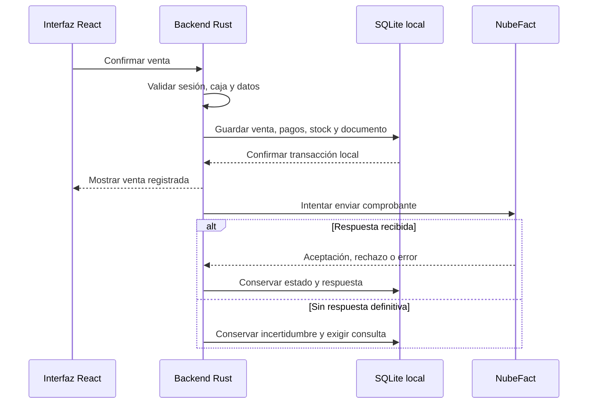

<div align="center">

# 🚗 Lubricentro Gloria

### Gestión de taller, inventario y ventas en una aplicación de escritorio

**Proyecto académico · Ingeniería de Sistemas · Perú**


[Presentación](#presentacion) · [Módulos](#modulos) · [Instalación](#instalacion) · [Pruebas](#pruebas)

</div>

---

## 📑 Contenido

1. [Presentación del proyecto](#presentacion)
2. [Vista general del sistema](#vista-general)
3. [Módulos del software](#modulos)
   - [3.1. Login y Sesión](#modulo-login-y-sesion)
   - [3.2. Inicio Dashboard](#modulo-inicio-dashboard)
   - [3.3. Ficha Vehicular e Historial](#modulo-ficha-vehicular-e-historial)
   - [3.4. Órdenes de Trabajo Taller](#modulo-ordenes-de-trabajo-taller)
   - [3.5. Inventario y Stock](#modulo-inventario-y-stock)
   - [3.6. Punto de Venta POS](#modulo-punto-de-venta-pos)
   - [3.7. Caja Chica](#modulo-caja-chica)
   - [3.8. Backup y Copias](#modulo-backup-y-copias)
   - [3.9. Administración](#modulo-administracion)
   - [3.10. Reportes](#modulo-reportes)
4. [Roles y permisos](#roles)
5. [Flujo de trabajo](#flujo)
6. [Arquitectura y base de datos](#arquitectura)
7. [Instalación y ejecución](#instalacion)
8. [Pruebas y calidad](#pruebas)
9. [Documentación](#documentacion)
10. [Autor y contexto académico](#autor)

---

<a id="presentacion"></a>

## 1. Presentación del proyecto

**Lubricentro Gloria** es un software de escritorio orientado a organizar la atención de vehículos, el trabajo del taller, las existencias, los cobros y el control de caja de **Lubricentro Gloria S.R.L.**

El proyecto conecta la información de cada atención: vehículo y cliente, servicios realizados, materiales consumidos, venta y comprobante. Su alcance también contempla ventas directas de productos y servicios.

### Objetivo

Facilitar el trabajo diario del lubricentro mediante procesos claros, permisos por rol y registros relacionados que eviten duplicar información, consumos o cobros.

### Tecnologías

| Tecnología             | Uso en el proyecto                                                        |
| ---------------------- | ------------------------------------------------------------------------- |
| **Tauri**              | Aplicación de escritorio y comunicación entre interfaz y backend.         |
| **React + TypeScript** | Pantallas, formularios y navegación.                                      |
| **Vite**               | Herramientas de desarrollo y compilación del frontend.                    |
| **Rust**               | Comandos, validaciones y lógica del negocio.                              |
| **SQLite**             | Almacenamiento local de los datos.                                        |
| **NubeFact**           | Integración definida para comprobantes electrónicos vinculados con SUNAT. |

### Estado del proyecto

**En desarrollo.** El alcance funcional está definido en los documentos v7 de los diez módulos y en el informe general. La implementación se está adaptando a esa definición.

Los apartados de cada módulo se completarán conforme se revise su código y se disponga de capturas y resultados de pruebas. El alcance documentado no implica que todas las funcionalidades ya estén implementadas.

<a id="vista-general"></a>

## 2. Vista general del sistema

La versión definida está orientada a **un establecimiento, una PC con Windows 11, una sesión de usuario activa y una caja abierta a la vez**, con tres roles: administrador, mecánico y cajero.

| Aspecto          | Alcance definido                                                          |
| ---------------- | ------------------------------------------------------------------------- |
| Operación        | Aplicación de escritorio con datos locales.                               |
| Atención         | Identificación del vehículo, recepción y ejecución de órdenes de trabajo. |
| Comercial        | Ventas al contado, cobro de OT y devoluciones controladas.                |
| Inventario       | Productos, servicios, entradas, consumos, ajustes y kardex.               |
| Comprobantes     | Boletas, facturas y notas de crédito mediante NubeFact.                   |
| Control          | Caja, reportes, auditoría y copias de seguridad.                          |
| Moneda y horario | Sol peruano (PEN) y hora del negocio `America/Lima`, UTC−05:00.           |

Las operaciones locales autorizadas están previstas para funcionar sin conexión permanente. Enviar o consultar comprobantes y descargar sus archivos oficiales requiere internet.

<!-- CAPTURA GENERAL: cuando esté disponible, guardar docs/images/dashboard.png
     y activar la siguiente línea. No publicar imágenes con datos reales o secretos.

-->

<a id="modulos"></a>

## 3. Módulos del software

<a id="modulo-login-y-sesion"></a>

### 3.1. Login y Sesión

**Descripción:**

**Funciones principales:**

**Acceso:**

**Captura de pantalla:**

**Estado:**

---

<a id="modulo-inicio-dashboard"></a>

### 3.2. Inicio Dashboard

**Descripción:**

**Funciones principales:**

**Acceso:**

**Captura de pantalla:**

**Estado:**

---

<a id="modulo-ficha-vehicular-e-historial"></a>

### 3.3. Ficha Vehicular e Historial

**Descripción:**

**Funciones principales:**

**Acceso:**

**Captura de pantalla:**

**Estado:**

---

<a id="modulo-ordenes-de-trabajo-taller"></a>

### 3.4. Órdenes de Trabajo Taller

**Descripción:**

**Funciones principales:**

**Acceso:**

**Captura de pantalla:**

**Estado:**

---

<a id="modulo-inventario-y-stock"></a>

### 3.5. Inventario y Stock

**Descripción:**

**Funciones principales:**

**Acceso:**

**Captura de pantalla:**

**Estado:**

---

<a id="modulo-punto-de-venta-pos"></a>

### 3.6. Punto de Venta POS

**Descripción:**

**Funciones principales:**

**Acceso:**

**Captura de pantalla:**

**Estado:**

---

<a id="modulo-caja-chica"></a>

### 3.7. Caja Chica

**Descripción:**

**Funciones principales:**

**Acceso:**

**Captura de pantalla:**

**Estado:**

---

<a id="modulo-backup-y-copias"></a>

### 3.8. Backup y Copias

**Descripción:**

**Funciones principales:**

**Acceso:**

**Captura de pantalla:**

**Estado:**

---

<a id="modulo-administracion"></a>

### 3.9. Administración

**Descripción:**

**Funciones principales:**

**Acceso:**

**Captura de pantalla:**

**Estado:**

---

<a id="modulo-reportes"></a>

### 3.10. Reportes

**Descripción:**

**Funciones principales:**

**Acceso:**

**Captura de pantalla:**

**Estado:**

---

<a id="roles"></a>

## 4. Roles y permisos

La siguiente matriz resume el **alcance funcional definido**. Las autorizaciones y restricciones específicas se desarrollan en los documentos de cada módulo.

| Módulo                      | Administrador                                              | Mecánico                                                    | Cajero                                         |
| --------------------------- | ---------------------------------------------------------- | ----------------------------------------------------------- | ---------------------------------------------- |
| Login y Sesión              | Cuenta propia y gestión autorizada.                        | Cuenta propia.                                              | Cuenta propia.                                 |
| Inicio Dashboard            | Resumen del negocio.                                       | Resumen de trabajos propios y disponibles.                  | Resumen de caja y OT por cobrar.               |
| Ficha Vehicular e Historial | Gestión y correcciones autorizadas.                        | Consulta de información pública de atención.                | Registro, edición de datos comunes y consulta. |
| Órdenes de Trabajo Taller   | Gestión del taller.                                        | Inicio de OT libres o propias y ejecución de las asignadas. | Recepción y consulta pública.                  |
| Inventario y Stock          | Catálogos, entradas, costos, kardex y ajustes.             | Consulta de activos, stock y precios.                       | Consulta de activos, stock y precios.          |
| Punto de Venta POS          | Operaciones con caja propia y gestión documental.          | Sin acceso.                                                 | Ventas propias; excepciones con autorización.  |
| Caja Chica                  | Turno propio; consulta y cierre administrativo autorizado. | Sin acceso.                                                 | Turnos propios.                                |
| Backup y Copias             | Configuración, copias y recuperación.                      | Sin acceso.                                                 | Sin acceso.                                    |
| Administración              | Usuarios, empresa, facturación y taller.                   | Sin acceso.                                                 | Sin acceso.                                    |
| Reportes                    | Consulta y exportación.                                    | Sin acceso.                                                 | Sin acceso.                                    |

Los permisos se deben validar en el backend. Ocultar un botón en la interfaz no sustituye esa validación. Los costos y las notas internas no se incluyen en respuestas dirigidas a roles sin autorización.

<a id="flujo"></a>

## 5. Flujo de trabajo

| Paso                     | Acción                                                              | Resultado esperado                                                     |
| ------------------------ | ------------------------------------------------------------------- | ---------------------------------------------------------------------- |
| **1. Identificar**       | Buscar la placa y verificar cliente y kilometraje.                  | Ficha seleccionada o registro de un vehículo nuevo.                    |
| **2. Recibir**           | Crear una OT con servicios y mecánico opcional.                     | Orden en espera, sin reserva ni descuento de stock.                    |
| **3. Ejecutar**          | Iniciar trabajo en una zanja libre y registrar consumos reales.     | Materiales descontados una vez y trabajo asignado.                     |
| **4. Finalizar**         | Confirmar kilometraje, resumen y tipo de aceite cuando corresponda. | OT finalizada, historial actualizado y zanja libre.                    |
| **5. Cobrar**            | Recuperar la OT desde POS y confirmar el pago.                      | Venta y cobro registrados sin repetir la salida de insumos del taller. |
| **6. Cerrar y proteger** | Contar efectivo, cerrar el turno y gestionar una copia.             | Cierre conservado y datos protegidos según la política de copias.      |

**Venta directa:** también está prevista la venta de productos o servicios desde POS sin crear una OT.

**Comprobante electrónico:** después del guardado local se realiza el intento de envío. Los errores o respuestas inciertas se atienden desde POS, sin registrar otra venta ni otro cobro. La devolución exige el original y las notas anteriores aceptados.

<a id="arquitectura"></a>

## 6. Arquitectura y base de datos

### Organización de la aplicación

| Capa              | Ubicación                                               | Responsabilidad                                                         |
| ----------------- | ------------------------------------------------------- | ----------------------------------------------------------------------- |
| Interfaz          | `src/`                                                  | Pantallas React, componentes, contexto, tipos y servicios del frontend. |
| Comandos          | `src-tauri/src/commands/`                               | Entrada a las operaciones del backend.                                  |
| Negocio           | `src-tauri/src/services/`                               | Validaciones y coordinación de procesos.                                |
| Datos y contratos | `src-tauri/src/entities/` y `src-tauri/src/dto/`        | Representación de datos y contratos de intercambio.                     |
| Base de datos     | `src-tauri/src/db.rs` y `src-tauri/migrations/`         | Conexión y evolución del esquema SQLite.                                |
| Integración       | `src-tauri/src/nubefact.rs`                             | Comunicación con NubeFact.                                              |
| Pruebas           | `src-tauri/tests/` y carpetas `__tests__/` del frontend | Casos automatizados de las capas correspondientes.                      |

### Guardado local e integración



Este diagrama describe el comportamiento definido para la integración, no una certificación del código actual.

### Esquema v7

- **27 tablas de aplicación y 6 vistas** en el esquema revisado.
- Historial vehicular consultado desde las OT finalizadas, sin una tabla duplicada de mantenimientos.
- Estado de envío y archivos del comprobante conservados en el propio documento.
- Un cierre de caja con conteo de efectivo y resúmenes digitales de lectura.
- Importes comerciales en céntimos; cantidades por unidad o mililitros y costos internos con precisión de seis decimales.
- Prueba y Producción con bases independientes.

El esquema v7 es de **inicialización de una base vacía**. Incorporarlo a una instalación con datos requiere una migración específica y adaptar el código que utiliza tablas o columnas anteriores. No se deben reemplazar migraciones ya aplicadas.

<!-- DIAGRAMA BD: cuando exista una imagen verificada, se puede insertar aquí:

-->

<a id="instalacion"></a>

## 7. Instalación y ejecución

### Requisitos para desarrollo en Windows

- Windows 11 de 64 bits como plataforma objetivo del proyecto.
- Node.js y npm compatibles con las dependencias del repositorio.
- Rust y Cargo con las herramientas de compilación para Windows.
- Microsoft C++ Build Tools con la carga de trabajo de desarrollo de escritorio con C++.
- Microsoft Edge WebView2 Runtime.
- Git, si se trabajará mediante un clon del repositorio.

Consultar los [requisitos oficiales de Tauri](https://v2.tauri.app/start/prerequisites/) para preparar las herramientas del equipo.

### Preparar dependencias

Abrir una terminal en la raíz del proyecto, donde se encuentra `package.json`:

```powershell
npm install
```

### Ejecutar en desarrollo

Con la CLI de Tauri instalada como dependencia del proyecto:

```powershell
npx tauri dev
```

La configuración de `src-tauri/tauri.conf.json` determina el comando previo del frontend y la dirección de desarrollo. Si allí se utilizan scripts npm, deben existir en `package.json`.

### Generar la compilación de escritorio

```powershell
npx tauri build
```

La generación de instaladores depende de la configuración de empaquetado y de las herramientas disponibles en Windows. Estos son los comandos estándar de Tauri; su ejecución en este repositorio debe comprobarse con sus archivos de configuración.

### Configuración inicial definida

1. Trabajar primero en **Prueba**, con datos ficticios.
2. Crear el primer administrador desde el flujo inicial de Login, sin credenciales compartidas por defecto.
3. Configurar empresa, NubeFact, series y zanjas desde Administración.
4. Registrar catálogos y existencias reales desde Inventario.
5. Configurar la protección y generar una primera copia desde Backup y Copias.
6. Validar el flujo completo de atención, cobro y cierre antes de utilizar Producción.

La inicialización de SQLite debe seguir el mecanismo del backend. No ejecutar manualmente un esquema inicial encima de una base que ya contiene datos.

**Entorno recomendado:** [Visual Studio Code](https://code.visualstudio.com/) con las extensiones [Tauri](https://marketplace.visualstudio.com/items?itemName=tauri-apps.tauri-vscode) y [rust-analyzer](https://marketplace.visualstudio.com/items?itemName=rust-lang.rust-analyzer).

<a id="pruebas"></a>

## 8. Pruebas y calidad

La validación del proyecto debe comprobar datos y permisos, además de la apariencia de las pantallas.

| Área                | Qué verificar                                                                  |
| ------------------- | ------------------------------------------------------------------------------ |
| Acceso              | Sesión válida, roles, bloqueos y protección de información.                    |
| Taller e inventario | Estados de OT, disponibilidad, consumos y ausencia de stock duplicado.         |
| POS y caja          | Venta única, pagos, devoluciones, efectivo disponible y cierre.                |
| Documentos          | Respuesta incierta, consulta previa al reenvío y ausencia de cobros repetidos. |
| Recuperación        | Copia válida, restauración completa y numeración conservada.                   |
| Hora del negocio    | Persistencia y consultas en Lima, incluso cerca de medianoche.                 |

### Comandos de comprobación

Desde la raíz, para ejecutar las pruebas Rust del manifiesto del backend:

```powershell
cargo test --manifest-path src-tauri/Cargo.toml
```

Para consultar los scripts disponibles del frontend:

```powershell
npm run
```

Ejecutar el script de pruebas que efectivamente esté definido en `package.json`. Las pruebas de integración con servicios externos deben usar el ambiente y las credenciales de Prueba; no emitir comprobantes de Producción como prueba automatizada.

### Estado de la validación

En la revisión independiente del esquema v7 se ejecutaron **27 casos sobre SQLite**, con resultado satisfactorio. Se verificaron creación, restricciones, relaciones y flujos de datos seleccionados. Estas verificaciones no representan una cobertura medida del repositorio ni una validación completa de Tauri, la interfaz o la API real de NubeFact.

La ejecución y el resultado de las pruebas del código se documentarán con evidencia de cada revisión. Este README no publica porcentajes de cobertura ni un estado de CI/CD sin verificar la configuración y la última ejecución del repositorio.

<a id="documentacion"></a>

## 9. Documentación

| Documento de referencia                     | Contenido                                                                            |
| ------------------------------------------- | ------------------------------------------------------------------------------------ |
| **Informe general del software v7**         | Propósito, alcance, roles, relaciones, funcionamiento y reglas comunes.              |
| **Especificaciones de los diez módulos v7** | Requerimientos, permisos, interfaz, reglas, manual de uso y criterios de aceptación. |
| **Esquema SQL v7**                          | Tablas, relaciones, restricciones, vistas y resumen de cambios.                      |

La documentación funcional y el código deben mantenerse alineados. Una modificación de reglas compartidas exige revisar los módulos afectados, el informe general y el esquema cuando corresponda.

<!-- Cuando los documentos estén incorporados al repositorio, añadir aquí enlaces
     relativos a sus rutas reales. No activar enlaces a archivos aún inexistentes.
     Para capturas futuras: docs/images/01-login.png ... docs/images/10-reportes.png.
     Insertar cada imagen bajo Captura de pantalla en su módulo correspondiente.
-->

<a id="autor"></a>

## 10. Autor y contexto académico

**Jesús Ángel Loza Yataco**  
Estudiante de Ingeniería de Sistemas — Perú.

Proyecto académico para aplicar desarrollo de software, diseño de datos, integración de servicios y aseguramiento de la calidad a la gestión de un lubricentro.

---

<div align="center">

**Lubricentro Gloria** · Atención vehicular, taller y gestión del negocio

</div>
