<div align="center">

# 🚗 Lubricentro Gloria

### Gestión de taller, inventario y ventas en una aplicación de escritorio

**Proyecto académico · Ingeniería de Sistemas · Perú**


[Progreso](#estado) · [Login](#modulo-login-y-sesion) · [Ficha vehicular](#modulo-ficha-vehicular-e-historial) · [Taller](#modulo-ordenes-de-trabajo-taller) · [Instalación](#instalacion) · [Documentación](#documentacion)

</div>

<a id="presentacion"></a>

## 1. Presentación

**Lubricentro Gloria** es una aplicación de escritorio para conectar atención vehicular, taller, inventario, ventas y caja en **Lubricentro Gloria S.R.L.** Busca evitar registros dispersos, consumos duplicados y cobros desvinculados del trabajo realizado.

**Objetivo:** facilitar la gestión diaria mediante procesos claros, datos relacionados y permisos por rol.

| Tecnología             | Uso en el proyecto                                                        |
| ---------------------- | ------------------------------------------------------------------------- |
| **Tauri**              | Aplicación de escritorio y comunicación entre interfaz y backend.         |
| **React + TypeScript** | Pantallas, formularios y navegación.                                      |
| **Vite**               | Herramientas de desarrollo y compilación del frontend.                    |
| **Rust**               | Comandos, validaciones y lógica del negocio.                              |
| **SQLite**             | Almacenamiento local de los datos.                                        |
| **NubeFact**           | Integración definida para comprobantes electrónicos vinculados con SUNAT. |

**Alcance:** un establecimiento, una PC con Windows 11, una sesión activa y una caja abierta a la vez. Moneda PEN y hora `America/Lima` (UTC−05:00). La operación local no requiere conexión permanente; NubeFact sí la requiere para envíos, consultas y archivos oficiales.

<a id="estado"></a>

## 2. Estado del proyecto

Desarrollo secuencial, módulo por módulo, conforme al alcance funcional v7. La última revisión sitúa **Login y Sesión en 95/100**, **Ficha Vehicular e Historial en 93/100** y **Órdenes de Trabajo Taller en 92/100**. El ciclo principal del taller está implementado y continúa en ajustes de cierre y validación. **El siguiente módulo de la secuencia es Inventario y Stock.** Inicio Dashboard se desarrollará al final para integrar datos de los demás módulos.

| Orden | Módulo                                                             | Estado                                 | Evaluación |
| ----- | ------------------------------------------------------------------ | -------------------------------------- | ---------- |
| 01    | [Login y Sesión](#modulo-login-y-sesion)                           | 🟢 Ajustes finales                     | 95/100     |
| 02    | [Ficha Vehicular e Historial](#modulo-ficha-vehicular-e-historial) | 🟢 Ajustes finales                     | 93/100     |
| 03    | [Órdenes de Trabajo Taller](#modulo-ordenes-de-trabajo-taller)     | 🟡 En curso · ajustes de cierre        | 92/100     |
| 04    | Inventario y Stock                                                 | ⚪ Pendiente de revisión y adaptación  | —          |
| 05    | Punto de Venta POS                                                 | ⚪ Pendiente                           | —          |
| 06    | Caja Chica                                                         | ⚪ Pendiente                           | —          |
| 07    | Backup y Copias                                                    | ⚪ Pendiente                           | —          |
| 08    | Administración                                                     | ⚪ Pendiente                           | —          |
| 09    | Reportes                                                           | ⚪ Pendiente                           | —          |
| 10    | Inicio Dashboard                                                   | ⚪ Pendiente; se desarrollará al final | —          |

**Leyenda:** ⚪ Pendiente · 🟡 En curso · 🟢 Ajustes finales · ✅ Completado.

> **Evaluación:** los puntajes reflejan implementación y alineación con los PDF de los módulos; no son porcentajes de avance, cobertura de pruebas ni aprobación de todos los recorridos en escritorio. Las filas pendientes pueden tener código previo. Los roles, flujos y diagramas describen el alcance definido.

<a id="modulos"></a>

## 3. Detalle de los módulos

<a id="modulo-login-y-sesion"></a>

<details>
<summary><b>01 · Login y Sesión</b> — 🟢 Ajustes finales · Evaluación: 95/100</summary>

**Qué hace:** controla el acceso mediante cuentas individuales y mantiene la sesión del trabajador. Identifica su rol y reúne los flujos de primera instalación, cambio y recuperación de contraseña.

**Funciones principales:**

- **Acceso individual:** identifica al trabajador, habilita los accesos de Administrador, Cajero o Mecánico y rechaza cuentas inactivas o bloqueadas.
- **Primer administrador:** permite crearlo únicamente cuando no existen cuentas, con contraseña definitiva y código de recuperación.
- **Cambio de contraseña:** admite cambio voluntario con la clave actual y exige reemplazar las temporales antes de operar, sin volver a pedir la temporal ya autenticada.
- **Recuperación administrativa:** verifica el código vigente, cambia la contraseña y renueva el código para invalidar el anterior.
- **Control de sesión:** una sesión por aplicación, vencimiento tras 15 minutos de inactividad y rechazo de acceso si la cuenta pierde vigencia. Salir no cierra caja ni cancela órdenes automáticamente.
- **Protección de acceso:** bloqueo de 15 minutos tras cinco fallos consecutivos de una cuenta existente.
- **Autorización administrativa:** comprueba credenciales desde la operación que las requiere y conserva la sesión del trabajador solicitante.

**Fortalezas de implementación:**

- Rust valida identidad, estado de sesión y restricciones; el control no depende solo de la interfaz.
- Contraseñas protegidas con hashes **Argon2id**, sin almacenar claves en texto.
- Instalación, cambio de contraseña y recuperación coordinados mediante transacciones y auditoría para evitar éxitos parciales.
- **30 pruebas de autenticación aprobadas** en la última revisión reportada, incluyendo bloqueo, recuperación, revocación y fallos de escritura.

**Acceso por rol:**

| Usuario                 | Alcance                                                                                                 |
| ----------------------- | ------------------------------------------------------------------------------------------------------- |
| Administrador           | Sesión propia, cambio de clave y recuperación con código; otras cuentas se gestionan en Administración. |
| Mecánico                | Sesión propia, cambio de clave y módulos autorizados.                                                   |
| Cajero                  | Sesión propia, cambio de clave y módulos autorizados.                                                   |
| Instalación sin cuentas | Creación exclusiva del primer administrador.                                                            |

Se requiere una cuenta activa y completar el cambio obligatorio antes de operar. Las contraseñas se protegen mediante hashes Argon2id.

**Capturas:**

_Inicio de sesión_


_Recuperación de acceso_


_Creación del primer administrador_

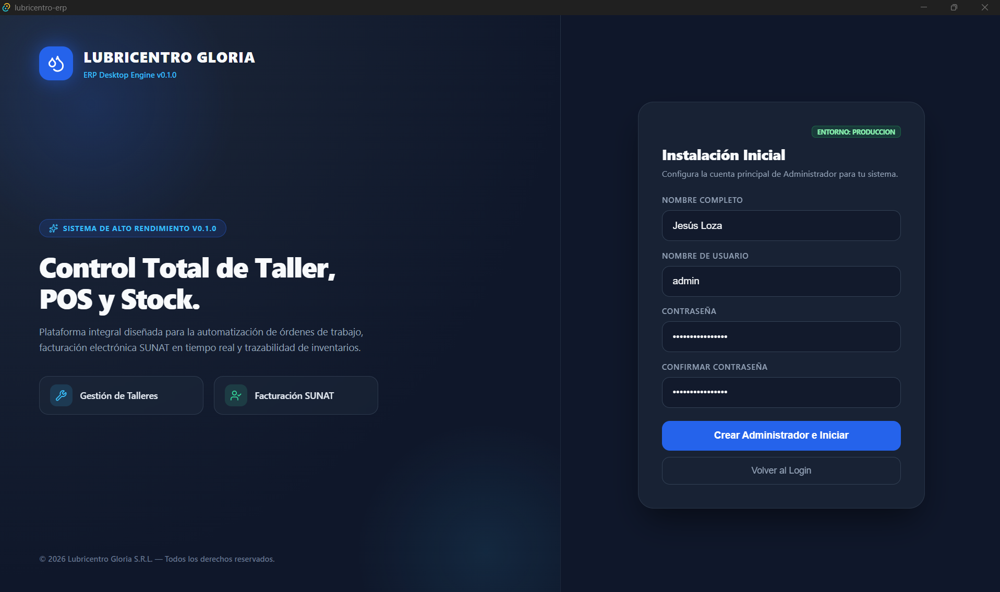

_Cambio de contraseña_

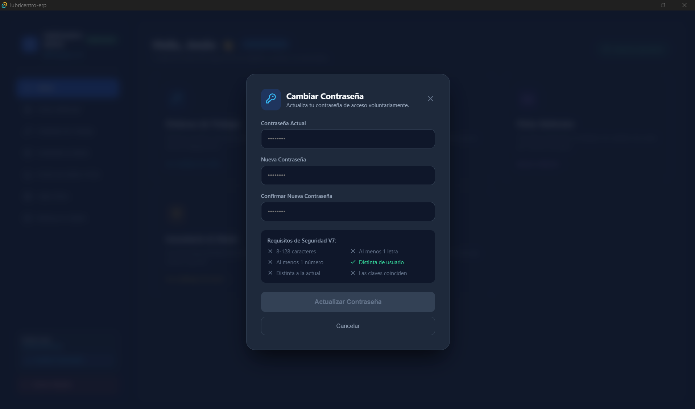

**Pendiente para cerrar:**

- Mostrar un error claro y permitir reintentar si falla la comprobación inicial de instalación.
- Activar el aviso de captura pendiente únicamente cuando existan modificaciones sin guardar.
- Completar evidencia de navegación por teclado, recorridos en escritorio y mediciones de tiempo de ingreso exigidas.

**Estado:** **95/100 en la última revisión**, con ajustes y validación de escritorio pendientes antes del cierre.

</details>

<a id="modulo-ficha-vehicular-e-historial"></a>

<details>
<summary><b>02 · Ficha Vehicular e Historial</b> — 🟢 Ajustes finales · Evaluación: 93/100</summary>

**Qué hace:** centraliza la identificación del vehículo, su propietario y las atenciones realizadas. Permite consultar la ficha y mantener sus datos relacionados con las órdenes del taller.

**Funciones principales:**

- **Buscar vehículos:** normaliza la placa y muestra vehículo, propietario, kilometraje y estado; permite limpiar la selección y reintentar consultas fallidas.
- **Registrar clientes y vehículos:** admite clientes sin vehículo, reutiliza clientes existentes y permite el registro conjunto de forma atómica.
- **Editar información:** administrador y cajero modifican datos comunes; cambiar placa, propietario o reducir kilometraje exige administrador y motivo.
- **Desactivar y reactivar:** conserva el historial, bloquea la desactivación si existe una OT abierta e impide recibir en Taller un vehículo inactivo.
- **Consultar mantenimientos:** muestra OT finalizadas, aunque estén pendientes de cobro, con **20 registros por página**, servicios, insumos, resumen, kilometraje, aceite y cliente histórico. «Ver atención» abre el detalle completo.
- **Corregir datos públicos:** el administrador puede ajustar kilometraje de atención, resumen o aceite cuando corresponde; la atención queda marcada como corregida y se registra auditoría.
- **Consultar próximos cambios:** búsqueda por placa o cliente, filtros por kilometraje, fecha o ambos, teléfono y acceso a la ficha. No registra llamadas ni oculta candidatos.
- **Abrir recepción:** lleva el vehículo seleccionado al formulario de OT y comprueba su actividad y la existencia de otra orden abierta.

**Fortalezas de implementación:**

- Historial vinculado al **ID del vehículo**: corregir la placa no desvincula las atenciones anteriores.
- Respuestas públicas específicas, sin notas técnicas ni costos; el mecánico tampoco recibe contactos del propietario.
- Paginación, filtros y conteos en SQLite, con orden definido.
- Restricciones persistentes, transacciones y auditoría para altas y cambios administrativos.
- Corregir una atención no modifica automáticamente el kilometraje actual ni mueve stock o dinero.
- **16 pruebas de vehículos aprobadas** en la última revisión reportada, además de comprobaciones adicionales de las correcciones recientes.

**Acceso por rol:**

| Rol           | Alcance                                                                                                                          |
| ------------- | -------------------------------------------------------------------------------------------------------------------------------- |
| Administrador | Gestión de ficha, cambio de placa o propietario, reducción de kilometraje, correcciones y desactivación/reactivación con motivo. |
| Cajero        | Registro, edición de datos comunes y consulta autorizada.                                                                        |
| Mecánico      | Consulta de información pública del vehículo y sus atenciones, sin contactos del propietario.                                    |

**Capturas:**

_Ficha vehicular principal_

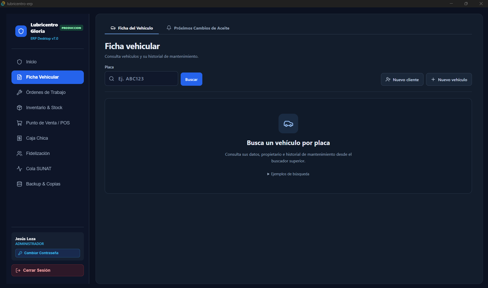

_Historial de atenciones_

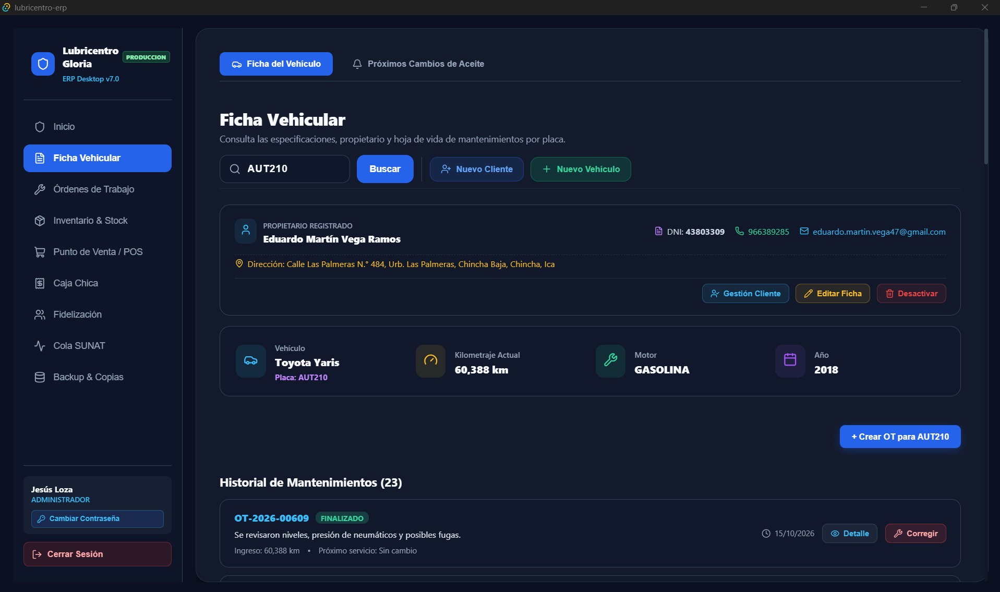

_Registro o edición del vehículo_

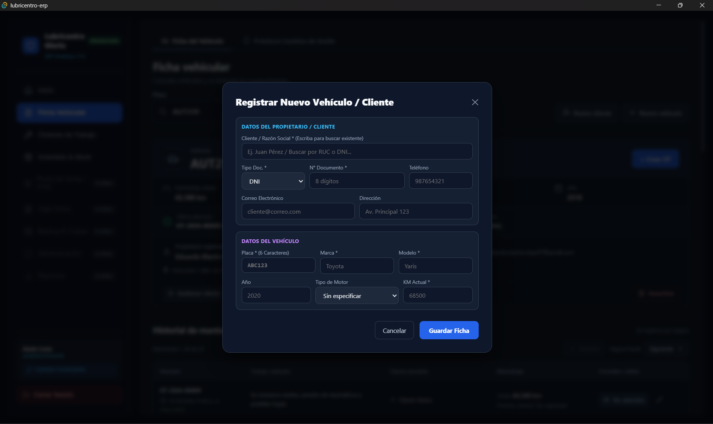

_Próximos cambios de aceite_

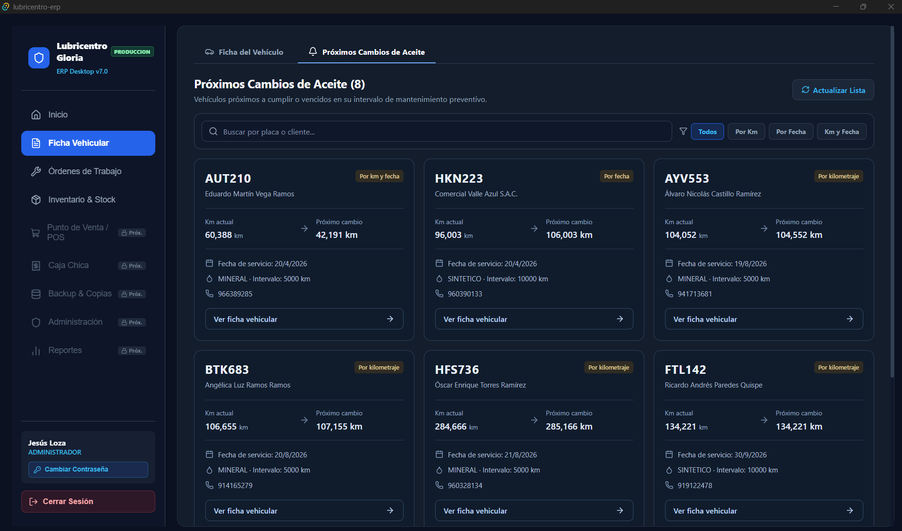

**Pendiente para cerrar:**

- Activar el indicador de captura pendiente al modificar datos, no al abrir el formulario.
- Distinguir un error al consultar el último aceite de la ausencia de un mantenimiento registrado.
- Incorporar a las pruebas permanentes los casos recientes de filtros, paginación, resumen y recepción.
- Completar los recorridos en escritorio y las cinco mediciones con el volumen de prueba definido.

**Estado:** **93/100 en la última revisión**. Las funciones principales están alineadas; el cierre se concentra en precisión de estados, tratamiento de errores y evidencia de validación.

</details>

<a id="modulo-ordenes-de-trabajo-taller"></a>

<details>
<summary><b>03 · Órdenes de Trabajo Taller</b> — 🟡 En curso · Evaluación: 92/100</summary>

**Qué hace:** organiza la atención del vehículo desde la recepción hasta la finalización o cancelación. Reúne servicios, responsable, zanja, materiales y resultado del trabajo, vinculados con Ficha Vehicular e Inventario.

**Funciones principales:**

- **Recepcionar vehículos:** selecciona un vehículo activo, registra kilometraje, pedido y servicio inicial; permite elegir mecánico o dejar la orden libre, evitando otra OT abierta para el mismo vehículo. Los ajustes de recepción frente al PDF se detallan entre los pendientes.
- **Consultar el tablero:** muestra primero las zanjas habilitadas y su ocupación, seguidas de una cola común de espera compacta. El mecánico consulta propias y libres; los trabajos ajenos se presentan sin información privada.
- **Buscar y listar órdenes:** ofrece páginas de **20 registros**, búsqueda por placa o código, filtros por estado, responsable y fechas, además de vistas de propias y libres. Propone la fecha de Lima y limita el rango a 366 días.
- **Iniciar trabajo:** exige una zanja habilitada y libre. El mecánico que inicia una orden libre queda asignado en la misma operación; el administrador selecciona responsable cuando falta.
- **Reasignar responsable:** el administrador puede cambiar al mecánico con motivo, conservando el creador y los datos originales.
- **Gestionar servicios:** administrador y mecánico propietario pueden agregar, modificar cantidades o retirar servicios mientras la OT esté abierta, manteniendo al menos uno. Los repetidos aumentan su línea al precio histórico.
- **Editar la nota interna:** permite una observación privada por orden, editable por administrador o mecánico responsable mientras esté abierta; queda separada del resumen público.
- **Registrar consumos:** descuenta materiales realmente utilizados durante la ejecución, conserva cantidades, precios y costos históricos y genera su movimiento de inventario.
- **Devolver materiales recuperados:** el administrador registra cantidad y motivo, sin superar el consumo neto; repone stock al costo de origen y conserva el retiro original.
- **Finalizar la atención:** propone kilometraje y resumen de servicios; registra aceite cuando corresponde, calcula próximo cambio, actualiza Ficha y libera la zanja.
- **Cancelar una orden:** el administrador confirma con motivo. Libera la zanja, conserva el consumo neto como costo interno y no devuelve stock automáticamente ni modifica el kilometraje del vehículo.
- **Recibir avisos de resultado:** muestra éxito después de confirmar el guardado y la causa de los rechazos, con el mismo componente de avisos de Ficha Vehicular. Los errores permanecen en el formulario y conservan lo escrito; si falla la recarga después de guardar, lo informa sin pedir repetir la operación.

**Fortalezas de implementación:**

- Validaciones de sesión, rol, responsable y estado desde Rust.
- Restricciones persistentes para una OT abierta por vehículo y una en proceso por zanja.
- Transacciones para mantener consistentes estado, inventario y kilometraje.
- Auditoría transaccional de recepción, inicio, nota, reasignación, finalización y cancelación.
- Privacidad según rol y propietario: cajero sin notas ni costos; mecánico sin notas ajenas ni costos internos.
- Cantidades de granel almacenadas en mililitros, con conversión y valoración verificadas.
- Identificador de operación en consumos y devoluciones: el backend evita repetir efectos cuando recibe el mismo identificador. Su conservación al reintentar desde la interfaz sigue pendiente.
- Modal organizado en hook, contenedor y componentes de acciones, servicios e insumos.
- **12 pruebas de Órdenes aprobadas** en la última revisión reportada, además de comprobaciones adicionales de auditoría, reversión e identificadores repetidos.

**Acceso por rol:**

| Rol           | Alcance                                                                                                                                                                                   |
| ------------- | ----------------------------------------------------------------------------------------------------------------------------------------------------------------------------------------- |
| Administrador | Recepción y gestión del taller; asignación y reasignación, notas, servicios, consumos, devolución de materiales y cancelación con motivo.                                                 |
| Mecánico      | Consulta de propias y libres; inicio de las permitidas y ejecución de sus órdenes. Gestiona servicios y nota interna en las condiciones autorizadas, sin costos internos ni notas ajenas. |
| Cajero        | Recepción y consulta pública autorizada, sin notas internas ni costos ni operaciones de ejecución reservadas.                                                                             |

**Capturas:**

_Tablero: zanjas y cola de espera_

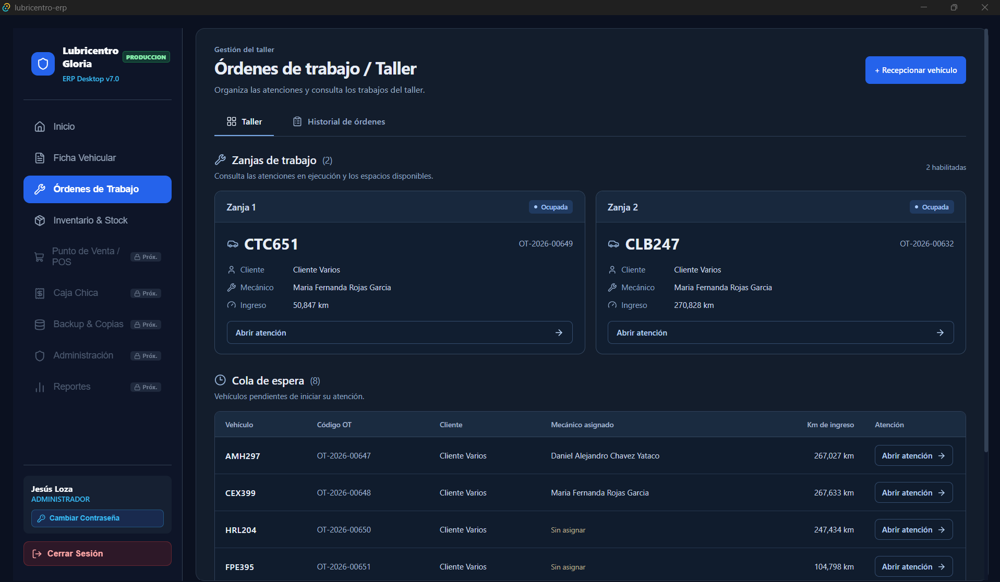

_Recepción del vehículo_

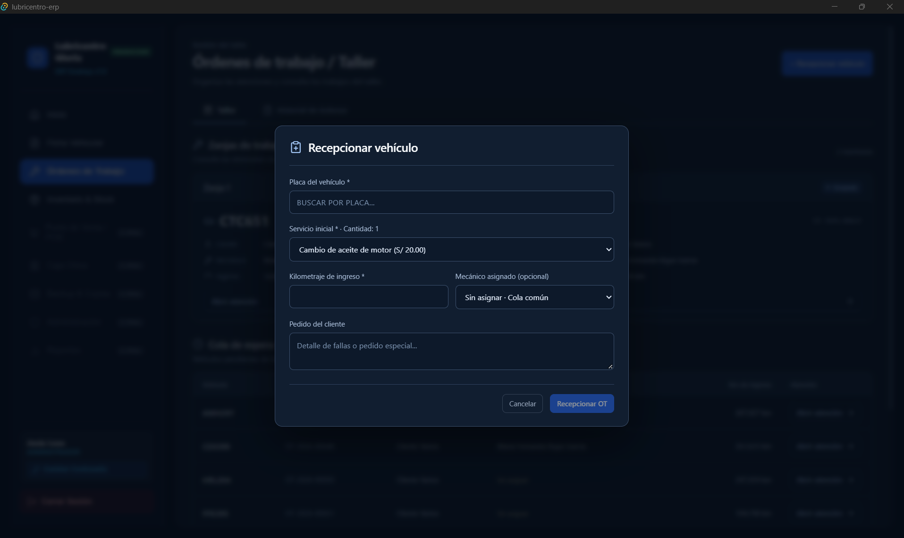

_Detalle: acciones, servicios e insumos_

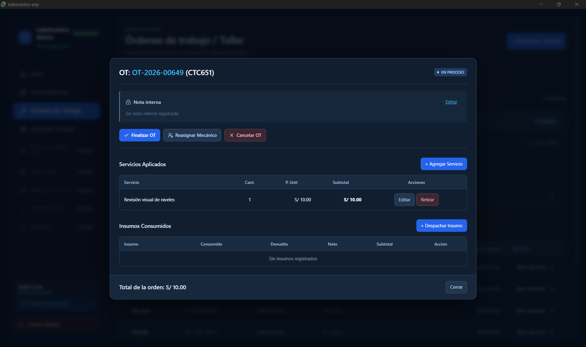

_Historial y filtros_

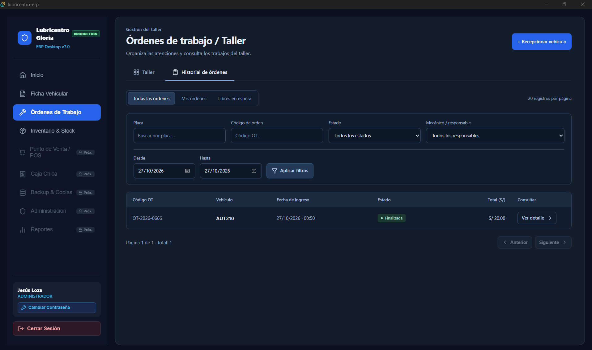

_Aviso de resultado de una operación_

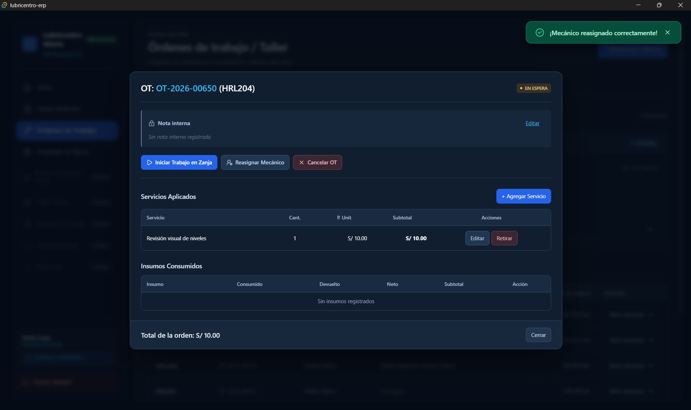

**Pendiente para cerrar:**

- Conservar el mismo identificador al reintentar una captura tras una respuesta incierta; actualmente la pantalla genera otro UUID.
- Completar la auditoría de cambios de servicios y la cobertura restante de movimientos.
- Ajustar la recepción al PDF: responsable inicialmente libre, kilometraje cero válido cuando corresponda y selección de varios servicios con sus cantidades.
- Completar la actualización manual general y la indicación explícita de datos desactualizados. Los mensajes de error recuperable y los reintentos ante fallos de consulta ya están incorporados.
- Incorporar pruebas permanentes de reintentos, auditoría y reversión ante fallos.
- Completar los recorridos en escritorio y las cinco mediciones con **2.000 OT**.

**Estado:** **92/100 en la última revisión**. El ciclo principal del taller está implementado; el cierre se concentra en completar la protección de reintentos desde la interfaz, la auditoría restante, los ajustes de recepción y la evidencia de validación.

</details>

**Trabajo actual:** completar los ajustes de cierre de Taller (**92/100**) y mantener el seguimiento de los pendientes de Login y Ficha Vehicular. **Siguiente módulo de la secuencia:** Inventario y Stock, con revisión de catálogos, entradas, consumos y ajustes.

<a id="roles"></a>

## 4. Roles y permisos

| Módulo                      | Administrador                                                          | Mecánico                                                                    | Cajero                                                      |
| --------------------------- | ---------------------------------------------------------------------- | --------------------------------------------------------------------------- | ----------------------------------------------------------- |
| Login y Sesión              | Cuenta propia y gestión autorizada.                                    | Cuenta propia.                                                              | Cuenta propia.                                              |
| Ficha Vehicular e Historial | Gestión y correcciones autorizadas.                                    | Consulta de información pública de atención.                                | Registro, edición de datos comunes y consulta.              |
| Órdenes de Trabajo Taller   | Gestión del taller, reasignación, devolución y cancelación con motivo. | Inicio de OT permitidas y ejecución de propias; sin notas ajenas ni costos. | Recepción y consulta pública; sin notas internas ni costos. |
| Inventario y Stock          | Catálogos, entradas, costos, kardex y ajustes.                         | Consulta de activos, stock y precios.                                       | Consulta de activos, stock y precios.                       |
| Punto de Venta POS          | Operaciones con caja propia y gestión documental.                      | Sin acceso.                                                                 | Ventas propias; excepciones con autorización.               |
| Caja Chica                  | Turno propio; consulta y cierre administrativo autorizado.             | Sin acceso.                                                                 | Turnos propios.                                             |
| Backup y Copias             | Configuración, copias y recuperación.                                  | Sin acceso.                                                                 | Sin acceso.                                                 |
| Administración              | Usuarios, empresa, facturación y taller.                               | Sin acceso.                                                                 | Sin acceso.                                                 |
| Reportes                    | Consulta y exportación.                                                | Sin acceso.                                                                 | Sin acceso.                                                 |
| Inicio Dashboard            | Resumen del negocio.                                                   | Resumen de trabajos propios y disponibles.                                  | Resumen de caja y OT por cobrar.                            |

Las autorizaciones se validan en Rust. Los costos y las notas internas se restringen por rol; ocultar botones no sustituye el control del backend.

<a id="flujo"></a>

## 5. Flujo de trabajo

| Paso                     | Acción                                                              | Resultado esperado                                                     |
| ------------------------ | ------------------------------------------------------------------- | ---------------------------------------------------------------------- |
| **1. Identificar**       | Buscar la placa y verificar cliente y kilometraje.                  | Ficha seleccionada o registro de un vehículo nuevo.                    |
| **2. Recibir**           | Crear una OT con servicio inicial y mecánico opcional.              | Orden en espera, sin reserva ni descuento de stock.                    |
| **3. Ejecutar**          | Iniciar trabajo en una zanja libre y registrar consumos reales.     | Materiales descontados una vez y trabajo asignado.                     |
| **4. Finalizar**         | Confirmar kilometraje, resumen y tipo de aceite cuando corresponda. | OT finalizada, historial actualizado y zanja libre.                    |
| **5. Cobrar**            | Recuperar la OT desde POS y confirmar el pago.                      | Venta y cobro registrados sin repetir la salida de insumos del taller. |
| **6. Cerrar y proteger** | Contar efectivo, cerrar el turno y gestionar una copia.             | Cierre conservado y datos protegidos según la política de copias.      |

**Venta directa:** el POS contempla productos y servicios sin crear una OT.

**Comprobante electrónico:** el envío ocurre después del guardado local. Las incidencias se atienden en POS sin otra venta ni cobro; devolver exige original y notas anteriores aceptados.

<a id="arquitectura"></a>

## 6. Arquitectura y base de datos

### 6.1. Organización del código

**Arquitectura en capas dentro de un monolito de escritorio organizado por módulos.** React/TypeScript presenta la interfaz y Rust aplica las reglas y consulta SQLite mediante comandos Tauri. El acceso a datos todavía comparte servicios con la lógica del negocio.

| Capa              | Ubicación                                               | Responsabilidad                                                         |
| ----------------- | ------------------------------------------------------- | ----------------------------------------------------------------------- |
| Interfaz          | `src/`                                                  | Pantallas React, componentes, contexto, tipos y servicios del frontend. |
| Comandos          | `src-tauri/src/commands/`                               | Entrada a las operaciones del backend.                                  |
| Negocio           | `src-tauri/src/services/`                               | Validaciones y coordinación de procesos.                                |
| Datos y contratos | `src-tauri/src/entities/` y `src-tauri/src/dto/`        | Representación de datos y contratos de intercambio.                     |
| Base de datos     | `src-tauri/src/db.rs` y `src-tauri/migrations/`         | Conexión y evolución del esquema SQLite.                                |
| Integración       | `src-tauri/src/nubefact.rs`                             | Comunicación con NubeFact.                                              |
| Pruebas           | `src-tauri/tests/` y carpetas `__tests__/` del frontend | Casos automatizados de las capas correspondientes.                      |

### 6.2. Guardado local e integración

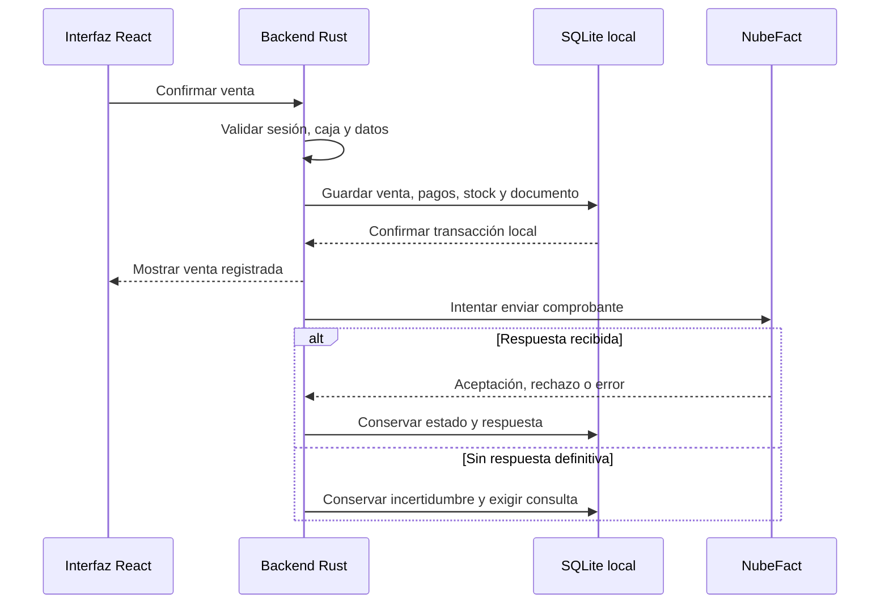

### 6.3. Esquema SQL v7

**27 tablas de aplicación y 6 vistas.** Historial desde OT finalizadas; estado de envío en comprobantes; cierre con conteo de efectivo y resúmenes digitales. Dinero comercial en céntimos, cantidades UND/ml y costos internos con seis decimales. Bases separadas para Prueba y Producción.

**El SQL inicial es exclusivamente para una base vacía.** Una instalación con datos necesita migración específica y adaptación del código; no reemplazar una migración ya aplicada.

<a id="instalacion"></a>

## 7. Instalación y ejecución

### 7.1. Requisitos

Windows 11 de 64 bits; Node.js/npm compatibles con el proyecto; Rust/Cargo; Microsoft C++ Build Tools con desarrollo de escritorio C++; WebView2 Runtime y Git para clonar. Ver [requisitos oficiales de Tauri](https://v2.tauri.app/start/prerequisites/).

Ejecutar desde la raíz del repositorio, donde está `package.json`.

### 7.2. Instalar dependencias

```powershell
npm install
```

### 7.3. Ejecutar en desarrollo

```powershell
npx tauri dev
```

### 7.4. Compilar

```powershell
npx tauri build
```

La configuración actual de Tauri invoca `npm run dev` antes del desarrollo y `npm run build` antes de compilar. Los scripts existen en `package.json`; el arranque y el instalador se validan en el equipo Windows objetivo.

### 7.5. Configuración inicial definida

1. Empezar en Prueba y crear el primer administrador, sin credenciales predeterminadas.
2. Configurar empresa, NubeFact, series y zanjas; registrar catálogos y existencias.
3. Preparar la protección de copias y validar atención, cobro y cierre antes de Producción.

<a id="pruebas"></a>

## 8. Pruebas y calidad

### 8.1. Qué se verifica

En Login: acceso, sesiones, permisos, bloqueo, recuperación, revocación y consistencia ante fallos. En Ficha Vehicular: registro, edición, identidad histórica, permisos, correcciones, consultas y paginación. En Taller: recepción, estados, responsable, zanjas, servicios, consumos, devoluciones, aceite, auditoría y avisos de resultado. Durante el avance de los demás módulos se validarán también ventas, cobros, cierre, comprobantes, recuperación, numeración y fechas de Lima.

### 8.2. Cómo ejecutarlas

Desde la raíz:

```powershell
npm run typecheck
npm test
npm run build
cargo test --manifest-path src-tauri/Cargo.toml
```

Las pruebas de integración externas deben usar datos y credenciales de Prueba. El flujo de [GitHub Actions](.github/workflows/ci.yml) define comprobaciones del frontend y backend; sus resultados se consultan en [Actions](https://github.com/JesusLoza1506/lubricentro-erp/actions).

### 8.3. Estado de la validación

La revisión reportada registró **30 pruebas de autenticación**, **16 de vehículos** y **12 de Órdenes aprobadas**. Estos resultados corresponden a los casos ejecutados; los casos recientes y la cobertura pendiente deben consolidarse en las suites permanentes.

Por separado, la validación del frontend realizada al incorporar los avisos de Taller aprobó **46 pruebas**, incluidas **19 nuevas** para mensajes, errores, datos conservados, fallos de recarga y cierre automático; también pasaron la comprobación de tipos y la compilación Vite. Esta validación usó servicios simulados y no acredita el funcionamiento completo en Windows/Tauri ni contra la BD real.

**Evaluación de implementación y alineación con los PDF:** Login **95/100**, Ficha Vehicular **93/100** y Taller **92/100**. Quedan pendientes los recorridos de escritorio y las mediciones indicadas en cada módulo; para Taller se requieren cinco mediciones con **2.000 OT**.

**Esquema verificado en SQLite:** 27 casos satisfactorios sobre creación, restricciones, relaciones y flujos seleccionados, correspondientes al esquema revisado. Esta evidencia se distingue de las pruebas de los módulos y no acredita la integración completa con NubeFact. Las revisiones de Login disponibles se enlazan en Documentación.

<a id="documentacion"></a>

## 9. Documentación

| Recurso                                                                  | Contenido                          |
| ------------------------------------------------------------------------ | ---------------------------------- |
| [Carpeta docs](docs/)                                                    | Documentos actualmente publicados. |
| [Revisión de Login v7 — R4](docs/Reevaluacion_Login_v7_2026-10-17_R4.md) | Revisión del módulo de acceso.     |
| [Comandos Tauri](docs/api/tauri-commands.md)                             | Referencia técnica existente.      |
| [Wireframes y diseño](docs/ui/wireframes-y-diseno.md)                    | Referencia de interfaz existente.  |
| [Esquema SQL v7](src-tauri/migrations/0001_initial_schema_v7.sql)        | Modelo inicial de datos.           |

El informe general y las diez especificaciones funcionales v7 son documentos de referencia; sus enlaces se incorporarán cuando estén publicados en el repositorio. Los cambios de reglas deben reflejarse en código, documentación y esquema cuando corresponda.

<a id="hoja-de-ruta"></a>

## 10. Hoja de ruta

La implementación seguirá este orden:

1. **Login y Sesión (evaluación: 95/100):** cerrar el manejo de errores iniciales, el aviso de cambios pendientes y las evidencias de escritorio.
2. **Ficha Vehicular e Historial (evaluación: 93/100):** afinar estados y errores de consulta; consolidar pruebas y mediciones.
3. **Órdenes de Trabajo Taller (evaluación: 92/100):** cerrar reintentos con el mismo identificador, auditoría pendiente, ajustes de recepción y validaciones de escritorio y rendimiento.
4. **Inventario y Stock — siguiente módulo:** revisar catálogos, entradas, consumos y ajustes, manteniendo la consistencia con Taller.
5. **Punto de Venta POS:** completar ventas, cobros y gestión de comprobantes.
6. **Caja Chica:** completar aperturas, movimientos y cierres.
7. **Backup y Copias:** completar copias de seguridad y recuperación.
8. **Administración:** completar la configuración y gestión autorizada.
9. **Reportes:** integrar las consultas y exportaciones de los módulos anteriores.
10. **Inicio Dashboard:** integrar al final los indicadores y resúmenes por rol con los datos de los demás módulos.

Cada módulo avanzará en la tabla de progreso y tendrá su detalle plegable, capturas y evidencias conforme se complete. Este orden de desarrollo no modifica el flujo operativo del taller descrito en la sección 5.

<a id="autor"></a>

## 11. Autores y licencia

- **Jesús Ángel Loza Yataco**
- **Esteban Ricardo Puma Palomino**
- **Reyes Esterripa Carlos Edén**
- **Magallanes Llanos Juan Jesús**

**Estudiantes de Ingeniería de Sistemas — Perú.** Proyecto académico para aplicar desarrollo, diseño de datos, integración de servicios y aseguramiento de la calidad a la gestión de un lubricentro.

**Licencia:** este README no incorpora una licencia de uso o distribución; su elección corresponde al acuerdo de los autores.
