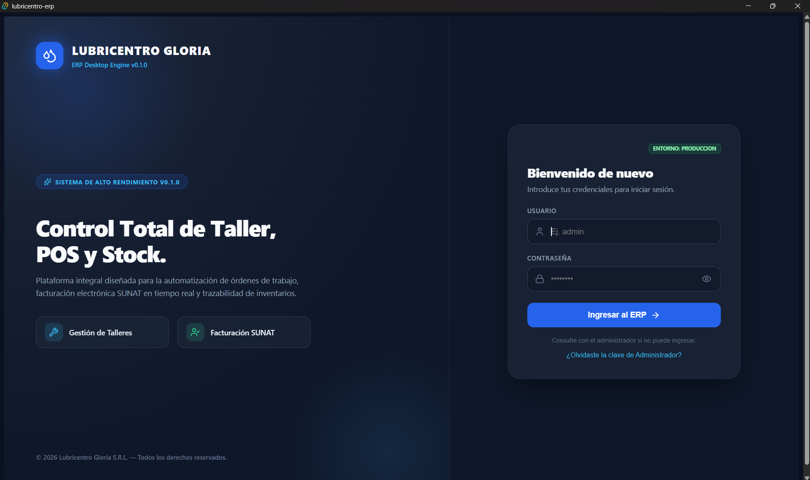
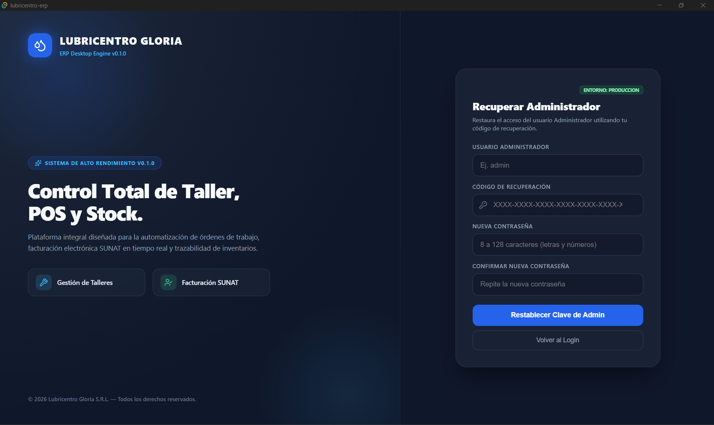
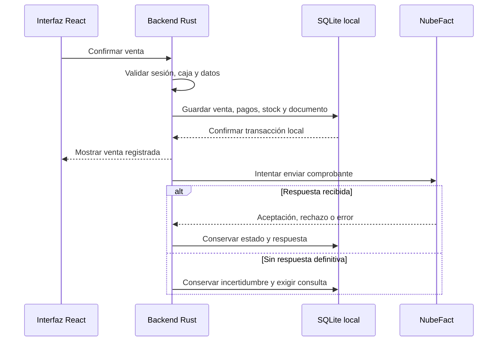

<div align="center">

# 🚗 Lubricentro Gloria

### Gestión de taller, inventario y ventas en una aplicación de escritorio

**Proyecto académico · Ingeniería de Sistemas · Perú**


[Progreso](#estado) · [Login](#modulo-login-y-sesion) · [Instalación](#instalacion) · [Documentación](#documentacion)

</div>

<a id="presentacion"></a>

## 1. Presentación

**Lubricentro Gloria** es una aplicación de escritorio para conectar atención vehicular, taller, inventario, ventas y caja en **Lubricentro Gloria S.R.L.** Busca evitar registros dispersos, consumos duplicados y cobros desvinculados del trabajo realizado.

**Objetivo:** facilitar la gestión diaria mediante procesos claros, datos relacionados y permisos por rol.

| Tecnología             | Uso en el proyecto                                                        |
| ---------------------- | ------------------------------------------------------------------------- |
| **Tauri**              | Aplicación de escritorio y comunicación entre interfaz y backend.         |
| **React + TypeScript** | Pantallas, formularios y navegación.                                      |
| **Vite**               | Herramientas de desarrollo y compilación del frontend.                    |
| **Rust**               | Comandos, validaciones y lógica del negocio.                              |
| **SQLite**             | Almacenamiento local de los datos.                                        |
| **NubeFact**           | Integración definida para comprobantes electrónicos vinculados con SUNAT. |

**Alcance:** un establecimiento, una PC con Windows 11, una sesión activa y una caja abierta a la vez. Moneda PEN y hora `America/Lima` (UTC−05:00). La operación local no requiere conexión permanente; NubeFact sí la requiere para envíos, consultas y archivos oficiales.

<a id="estado"></a>

## 2. Estado del proyecto

Desarrollo secuencial, módulo por módulo, conforme al alcance funcional v7.

| #   | Módulo                                   | Estado                                | Avance |
| --- | ---------------------------------------- | ------------------------------------- | ------ |
| 01  | [Login y Sesión](#modulo-login-y-sesion) | 🟢 Ajustes finales                    | ~90 %  |
| 02  | Inicio Dashboard                         | ⚪ Pendiente de revisión y adaptación | —      |
| 03  | Ficha Vehicular e Historial              | ⚪ Pendiente de revisión y adaptación | —      |
| 04  | Órdenes de Trabajo Taller                | ⚪ Pendiente de revisión y adaptación | —      |
| 05  | Inventario y Stock                       | ⚪ Pendiente de revisión y adaptación | —      |
| 06  | Punto de Venta POS                       | ⚪ Pendiente                          | —      |
| 07  | Caja Chica                               | ⚪ Pendiente                          | —      |
| 08  | Backup y Copias                          | ⚪ Pendiente                          | —      |
| 09  | Administración                           | ⚪ Pendiente                          | —      |
| 10  | Reportes                                 | ⚪ Pendiente                          | —      |

**Leyenda:** ⚪ Pendiente · 🟡 En curso · 🟢 Ajustes finales · ✅ Completado.

> El porcentaje estima implementación, no cobertura de pruebas. Las filas pendientes indican trabajo por completar o validar; puede existir código previo. Los roles, flujos y diagramas describen el alcance definido y no certifican que todo el sistema esté terminado.

<a id="modulos"></a>

## 3. Detalle de los módulos

<a id="modulo-login-y-sesion"></a>

<details>
<summary><b>01 · Login y Sesión</b> — 🟢 Ajustes finales · ~90 %</summary>

**Qué hace:** controla el acceso mediante cuentas individuales y mantiene la sesión del trabajador. Identifica su rol y reúne los flujos de primera instalación, cambio y recuperación de contraseña.

**Funciones principales:**

- Ingreso con usuario y contraseña y acceso al Dashboard según el rol.
- Creación del primer administrador solo en una instalación sin cuentas, con código de recuperación.
- Menú y operaciones autorizados para Administrador, Mecánico o Cajero, validados en backend.
- Cambio voluntario de clave y cambio obligatorio de temporal por nueva contraseña y confirmación.
- Recuperación administrativa con código; recuperación de trabajadores mediante administrador autorizado.
- Bloqueo temporal de Login: cinco fallos consecutivos de una cuenta existente, durante 15 minutos.
- Una sesión por aplicación y vencimiento tras 15 minutos de inactividad humana.
- Cierre de sesión con aviso por captura sin guardar, sin cerrar caja ni cancelar trabajos automáticamente.

**Acceso por rol:**

| Usuario                 | Alcance                                                                                                 |
| ----------------------- | ------------------------------------------------------------------------------------------------------- |
| Administrador           | Sesión propia, cambio de clave y recuperación con código; otras cuentas se gestionan en Administración. |
| Mecánico                | Sesión propia, cambio de clave y módulos autorizados.                                                   |
| Cajero                  | Sesión propia, cambio de clave y módulos autorizados.                                                   |
| Instalación sin cuentas | Creación exclusiva del primer administrador.                                                            |

Se requiere cuenta activa y completar el cambio obligatorio antes de operar. Las contraseñas se protegen mediante hashes Argon2id.

**Capturas:**

_Inicio de sesión_



_Recuperación de acceso_



Capturas por incorporar: primer administrador (`docs/images/01-login-primer-administrador.png`) y cambio de contraseña (`docs/images/01-login-cambio-clave.png`).

**Pendiente para cerrar:** mejoras menores, validaciones complementarias y consolidación de evidencias de prueba.

**Estado:** desarrollo completado aproximadamente al **90 %**, en fase de ajustes finales antes de su cierre definitivo.

</details>

Los módulos 02–10 se incorporarán aquí conforme avance su revisión e implementación.

<a id="roles"></a>

## 4. Roles y permisos

| Módulo                      | Administrador                                              | Mecánico                                                    | Cajero                                         |
| --------------------------- | ---------------------------------------------------------- | ----------------------------------------------------------- | ---------------------------------------------- |
| Login y Sesión              | Cuenta propia y gestión autorizada.                        | Cuenta propia.                                              | Cuenta propia.                                 |
| Inicio Dashboard            | Resumen del negocio.                                       | Resumen de trabajos propios y disponibles.                  | Resumen de caja y OT por cobrar.               |
| Ficha Vehicular e Historial | Gestión y correcciones autorizadas.                        | Consulta de información pública de atención.                | Registro, edición de datos comunes y consulta. |
| Órdenes de Trabajo Taller   | Gestión del taller.                                        | Inicio de OT libres o propias y ejecución de las asignadas. | Recepción y consulta pública.                  |
| Inventario y Stock          | Catálogos, entradas, costos, kardex y ajustes.             | Consulta de activos, stock y precios.                       | Consulta de activos, stock y precios.          |
| Punto de Venta POS          | Operaciones con caja propia y gestión documental.          | Sin acceso.                                                 | Ventas propias; excepciones con autorización.  |
| Caja Chica                  | Turno propio; consulta y cierre administrativo autorizado. | Sin acceso.                                                 | Turnos propios.                                |
| Backup y Copias             | Configuración, copias y recuperación.                      | Sin acceso.                                                 | Sin acceso.                                    |
| Administración              | Usuarios, empresa, facturación y taller.                   | Sin acceso.                                                 | Sin acceso.                                    |
| Reportes                    | Consulta y exportación.                                    | Sin acceso.                                                 | Sin acceso.                                    |

Las autorizaciones se validan en Rust. Los costos y las notas internas se restringen por rol; ocultar botones no sustituye el control del backend.

<a id="flujo"></a>

## 5. Flujo de trabajo

| Paso                     | Acción                                                              | Resultado esperado                                                     |
| ------------------------ | ------------------------------------------------------------------- | ---------------------------------------------------------------------- |
| **1. Identificar**       | Buscar la placa y verificar cliente y kilometraje.                  | Ficha seleccionada o registro de un vehículo nuevo.                    |
| **2. Recibir**           | Crear una OT con servicios y mecánico opcional.                     | Orden en espera, sin reserva ni descuento de stock.                    |
| **3. Ejecutar**          | Iniciar trabajo en una zanja libre y registrar consumos reales.     | Materiales descontados una vez y trabajo asignado.                     |
| **4. Finalizar**         | Confirmar kilometraje, resumen y tipo de aceite cuando corresponda. | OT finalizada, historial actualizado y zanja libre.                    |
| **5. Cobrar**            | Recuperar la OT desde POS y confirmar el pago.                      | Venta y cobro registrados sin repetir la salida de insumos del taller. |
| **6. Cerrar y proteger** | Contar efectivo, cerrar el turno y gestionar una copia.             | Cierre conservado y datos protegidos según la política de copias.      |

**Venta directa:** el POS contempla productos y servicios sin crear una OT.

**Comprobante electrónico:** el envío ocurre después del guardado local. Las incidencias se atienden en POS sin otra venta ni cobro; devolver exige original y notas anteriores aceptados.

<a id="arquitectura"></a>

## 6. Arquitectura y base de datos

### 6.1. Organización del código

**Arquitectura en capas dentro de un monolito de escritorio organizado por módulos.** React/TypeScript presenta la interfaz y Rust aplica las reglas y consulta SQLite mediante comandos Tauri. El acceso a datos todavía comparte servicios con la lógica del negocio.

| Capa              | Ubicación                                               | Responsabilidad                                                         |
| ----------------- | ------------------------------------------------------- | ----------------------------------------------------------------------- |
| Interfaz          | `src/`                                                  | Pantallas React, componentes, contexto, tipos y servicios del frontend. |
| Comandos          | `src-tauri/src/commands/`                               | Entrada a las operaciones del backend.                                  |
| Negocio           | `src-tauri/src/services/`                               | Validaciones y coordinación de procesos.                                |
| Datos y contratos | `src-tauri/src/entities/` y `src-tauri/src/dto/`        | Representación de datos y contratos de intercambio.                     |
| Base de datos     | `src-tauri/src/db.rs` y `src-tauri/migrations/`         | Conexión y evolución del esquema SQLite.                                |
| Integración       | `src-tauri/src/nubefact.rs`                             | Comunicación con NubeFact.                                              |
| Pruebas           | `src-tauri/tests/` y carpetas `__tests__/` del frontend | Casos automatizados de las capas correspondientes.                      |

### 6.2. Guardado local e integración



### 6.3. Esquema SQL v7

**27 tablas de aplicación y 6 vistas.** Historial desde OT finalizadas; estado de envío en comprobantes; cierre con conteo de efectivo y resúmenes digitales. Dinero comercial en céntimos, cantidades UND/ml y costos internos con seis decimales. Bases separadas para Prueba y Producción.

**El SQL inicial es exclusivamente para una base vacía.** Una instalación con datos necesita migración específica y adaptación del código; no reemplazar una migración ya aplicada.

<a id="instalacion"></a>

## 7. Instalación y ejecución

### 7.1. Requisitos

Windows 11 de 64 bits; Node.js/npm compatibles con el proyecto; Rust/Cargo; Microsoft C++ Build Tools con desarrollo de escritorio C++; WebView2 Runtime y Git para clonar. Ver [requisitos oficiales de Tauri](https://v2.tauri.app/start/prerequisites/).

Ejecutar desde la raíz del repositorio, donde está `package.json`.

### 7.2. Instalar dependencias

```powershell
npm install
```

### 7.3. Ejecutar en desarrollo

```powershell
npx tauri dev
```

### 7.4. Compilar

```powershell
npx tauri build
```

La configuración actual de Tauri invoca `npm run dev` antes del desarrollo y `npm run build` antes de compilar. Los scripts existen en `package.json`; el arranque y el instalador se validan en el equipo Windows objetivo.

### 7.5. Configuración inicial definida

1. Empezar en Prueba y crear el primer administrador, sin credenciales predeterminadas.
2. Configurar empresa, NubeFact, series y zanjas; registrar catálogos y existencias.
3. Preparar la protección de copias y validar atención, cobro y cierre antes de Producción.

<a id="pruebas"></a>

## 8. Pruebas y calidad

### 8.1. Qué se verifica

Sesiones y permisos; estados de OT; stock sin duplicaciones; ventas, devoluciones y cierre; documentos inciertos y reenvío; recuperación, numeración y fechas de Lima.

### 8.2. Cómo ejecutarlas

Desde la raíz:

```powershell
npm test
npm run typecheck
cargo test --manifest-path src-tauri/Cargo.toml
```

Las pruebas de integración externas deben usar datos y credenciales de Prueba. El flujo de [GitHub Actions](.github/workflows/ci.yml) define comprobaciones del frontend y backend; sus resultados se consultan en [Actions](https://github.com/JesusLoza1506/lubricentro-erp/actions).

### 8.3. Estado de la validación

**Esquema verificado en SQLite:** 27 casos satisfactorios sobre creación, restricciones, relaciones y flujos seleccionados. Esta evidencia corresponde al esquema revisado, no a la ejecución completa del código ni de NubeFact. Las revisiones de Login disponibles se enlazan en Documentación.

<a id="documentacion"></a>

## 9. Documentación

| Recurso                                                                  | Contenido                          |
| ------------------------------------------------------------------------ | ---------------------------------- |
| [Carpeta docs](docs/)                                                    | Documentos actualmente publicados. |
| [Revisión de Login v7 — R4](docs/Reevaluacion_Login_v7_2026-10-17_R4.md) | Revisión del módulo de acceso.     |
| [Comandos Tauri](docs/api/tauri-commands.md)                             | Referencia técnica existente.      |
| [Wireframes y diseño](docs/ui/wireframes-y-diseno.md)                    | Referencia de interfaz existente.  |
| [Esquema SQL v7](src-tauri/migrations/0001_initial_schema_v7.sql)        | Modelo inicial de datos.           |

El informe general y las diez especificaciones funcionales v7 son documentos de referencia; sus enlaces se incorporarán cuando estén publicados en el repositorio. Los cambios de reglas deben reflejarse en código, documentación y esquema cuando corresponda.

<a id="hoja-de-ruta"></a>

## 10. Hoja de ruta

- [ ] **01:** cerrar ajustes y validaciones de Login y Sesión.
- [ ] **02–03:** revisar y adaptar Dashboard y Ficha Vehicular e Historial.
- [ ] **04–05:** revisar y adaptar Órdenes de Trabajo Taller e Inventario y Stock.
- [ ] **06–07:** completar Punto de Venta POS y Caja Chica.
- [ ] **08–09:** completar Backup y Copias y Administración.
- [ ] **10:** completar Reportes y validar el flujo integrado del software.

Cada módulo avanzará en la tabla de progreso y tendrá su detalle plegable, capturas y evidencias conforme se complete.

<a id="autor"></a>

## 11. Autores y licencia

- **Jesús Ángel Loza Yataco**
- **Esteban Ricardo Puma Palomino**
- **Reyes Esterripa Carlos Edén**
- **Magallanes Llanos Juan Jesús**

**Estudiantes de Ingeniería de Sistemas — Perú.** Proyecto académico para aplicar desarrollo, diseño de datos, integración de servicios y aseguramiento de la calidad a la gestión de un lubricentro.

**Licencia:** este README no incorpora una licencia de uso o distribución; su elección corresponde al acuerdo de los autores.
