<div align="center">

# 🚗 Lubricentro Gloria

### Gestión de taller, inventario y ventas en una aplicación de escritorio

**Proyecto académico · Ingeniería de Sistemas · Perú**


[Progreso](#estado) · [Login](#modulo-login-y-sesion) · [Ficha vehicular](#modulo-ficha-vehicular-e-historial) · [Taller](#modulo-ordenes-de-trabajo-taller) · [Inventario](#modulo-inventario-y-stock) · [POS](#modulo-punto-de-venta-pos) · [Caja Chica](#modulo-caja-chica) · [Backup y Copias](#modulo-backup-y-copias) · [Administración](#modulo-administracion) · [Reportes](#modulo-reportes) · [Instalación](#instalacion) · [Documentación](#documentacion)

</div>

<a id="presentacion"></a>

## 1. Presentación

**Lubricentro Gloria** es una aplicación de escritorio para conectar atención vehicular, taller, inventario, ventas y caja en **Lubricentro Gloria S.R.L.** Busca evitar registros dispersos, consumos duplicados y cobros desvinculados del trabajo realizado.

**Objetivo:** facilitar la gestión diaria mediante procesos claros, datos relacionados y permisos por rol.

| Tecnología             | Uso en el proyecto                                                        |
| ---------------------- | ------------------------------------------------------------------------- |
| **Tauri**              | Aplicación de escritorio y comunicación entre interfaz y backend.         |
| **React + TypeScript** | Pantallas, formularios y navegación.                                      |
| **Vite**               | Herramientas de desarrollo y compilación del frontend.                    |
| **Rust**               | Comandos, validaciones y lógica del negocio.                              |
| **SQLite**             | Almacenamiento local de los datos.                                        |
| **NubeFact**           | Integración definida para comprobantes electrónicos vinculados con SUNAT. |

**Alcance:** un establecimiento, una PC con Windows 11, una sesión activa y una caja abierta a la vez. Moneda PEN y hora `America/Lima` (UTC−05:00). La operación local no requiere conexión permanente; NubeFact sí la requiere para envíos, consultas y archivos oficiales.

<a id="estado"></a>

## 2. Estado del proyecto

Desarrollo secuencial, módulo por módulo, conforme al alcance funcional v7. **Login y Sesión (95/100)**, **Ficha Vehicular e Historial (93/100)**, **Órdenes de Trabajo Taller (93/100)**, **Inventario y Stock (95/100)**, **Punto de Venta POS (95/100)**, **Caja Chica (94/100)**, **Backup y Copias (94/100)** y **Administración (96/100)** se encuentran en **ajustes finales**. Sus funciones principales ya están implementadas; los pendientes de cierre y la validación en escritorio se detallan en cada módulo.

**El próximo módulo es Reportes.** Su implementación está pendiente y abarcará la consulta y exportación autorizadas de datos de los módulos anteriores. La integración final de Inicio Dashboard se mantiene para después de Reportes.

| Orden | Módulo                                                             | Estado                                 | Evaluación |
| ----- | ------------------------------------------------------------------ | -------------------------------------- | ---------- |
| 01    | [Login y Sesión](#modulo-login-y-sesion)                           | 🟢 Ajustes finales                     | 95/100     |
| 02    | [Ficha Vehicular e Historial](#modulo-ficha-vehicular-e-historial) | 🟢 Ajustes finales                     | 93/100     |
| 03    | [Órdenes de Trabajo Taller](#modulo-ordenes-de-trabajo-taller)     | 🟢 Ajustes finales                     | 93/100     |
| 04    | [Inventario y Stock](#modulo-inventario-y-stock)                   | 🟢 Ajustes finales                     | 95/100     |
| 05    | [Punto de Venta POS](#modulo-punto-de-venta-pos)                   | 🟢 Ajustes finales                     | 95/100     |
| 06    | [Caja Chica](#modulo-caja-chica)                                   | 🟢 Ajustes finales                     | 94/100     |
| 07    | [Backup y Copias](#modulo-backup-y-copias)                         | 🟢 Ajustes finales                     | 94/100     |
| 08    | [Administración](#modulo-administracion)                         | 🟢 Ajustes finales                     | 96/100     |
| 09    | [Reportes](#modulo-reportes)                                       | ⚪ Pendiente · próximo módulo          | —          |
| 10    | Inicio Dashboard                                                   | ⚪ Pendiente de integración final      | —          |

**Leyenda:** ⚪ Pendiente · 🟡 En curso · 🟢 Ajustes finales · ✅ Completado.

> **Evaluación:** los puntajes reflejan implementación y alineación con los PDF de los módulos; no son porcentajes de avance, cobertura de pruebas ni aprobación de todos los recorridos en escritorio. Las filas pendientes pueden tener código previo. Los roles, flujos y diagramas describen el alcance definido.

<a id="modulos"></a>

## 3. Detalle de los módulos

<a id="modulo-login-y-sesion"></a>

<details>
<summary><b>01 · Login y Sesión</b> — 🟢 Ajustes finales · Evaluación: 95/100</summary>

**Qué hace:** controla el acceso mediante cuentas individuales y mantiene la sesión del trabajador. Identifica su rol y reúne los flujos de primera instalación, cambio y recuperación de contraseña.

**Funciones principales:**

- **Acceso individual:** identifica al trabajador, habilita los accesos de Administrador, Cajero o Mecánico y rechaza cuentas inactivas o bloqueadas.
- **Primer administrador:** permite crearlo únicamente cuando no existen cuentas, con contraseña definitiva y código de recuperación.
- **Cambio de contraseña:** admite cambio voluntario con la clave actual y exige reemplazar las temporales antes de operar, sin volver a pedir la temporal ya autenticada.
- **Recuperación administrativa:** verifica el código vigente, cambia la contraseña y renueva el código para invalidar el anterior.
- **Control de sesión:** una sesión por aplicación, vencimiento tras 15 minutos de inactividad y rechazo de acceso si la cuenta pierde vigencia. Salir no cierra caja ni cancela órdenes automáticamente.
- **Protección de acceso:** bloqueo de 15 minutos tras cinco fallos consecutivos de una cuenta existente.
- **Autorización administrativa:** comprueba credenciales desde la operación que las requiere y conserva la sesión del trabajador solicitante.

**Fortalezas de implementación:**

- Rust valida identidad, estado de sesión y restricciones; el control no depende solo de la interfaz.
- Contraseñas protegidas con hashes **Argon2id**, sin almacenar claves en texto.
- Instalación, cambio de contraseña y recuperación coordinados mediante transacciones y auditoría para evitar éxitos parciales.
- **30 pruebas de autenticación aprobadas** en la última revisión reportada, incluyendo bloqueo, recuperación, revocación y fallos de escritura.

**Acceso por rol:**

| Usuario                 | Alcance                                                                                                 |
| ----------------------- | ------------------------------------------------------------------------------------------------------- |
| Administrador           | Sesión propia, cambio de clave y recuperación con código; otras cuentas se gestionan en Administración. |
| Mecánico                | Sesión propia, cambio de clave y módulos autorizados.                                                   |
| Cajero                  | Sesión propia, cambio de clave y módulos autorizados.                                                   |
| Instalación sin cuentas | Creación exclusiva del primer administrador.                                                            |

Se requiere una cuenta activa y completar el cambio obligatorio antes de operar. Las contraseñas se protegen mediante hashes Argon2id.

**Capturas:**

_Inicio de sesión_

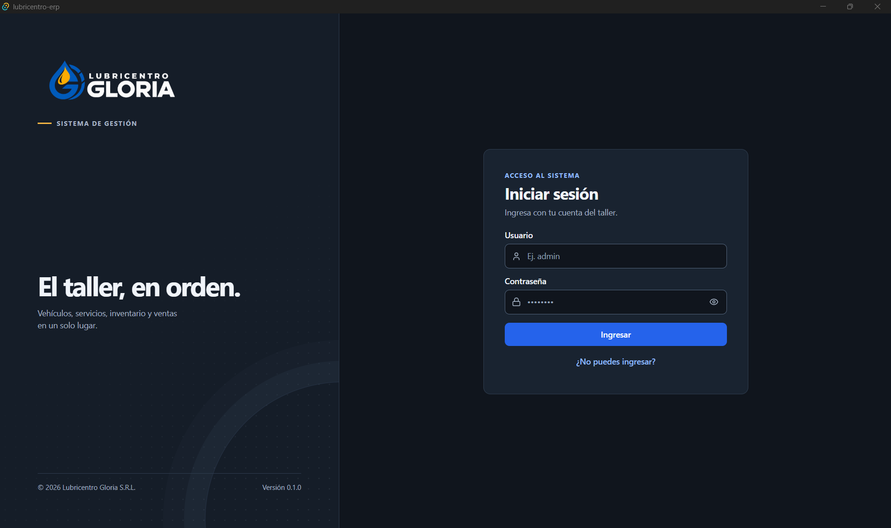

_Recuperación de acceso_

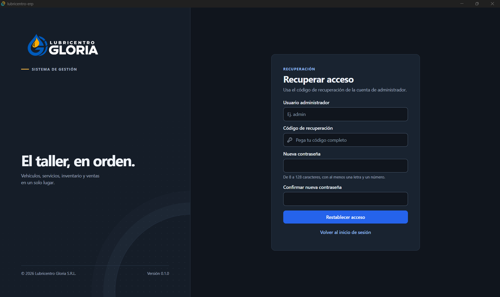

_Creación del primer administrador_

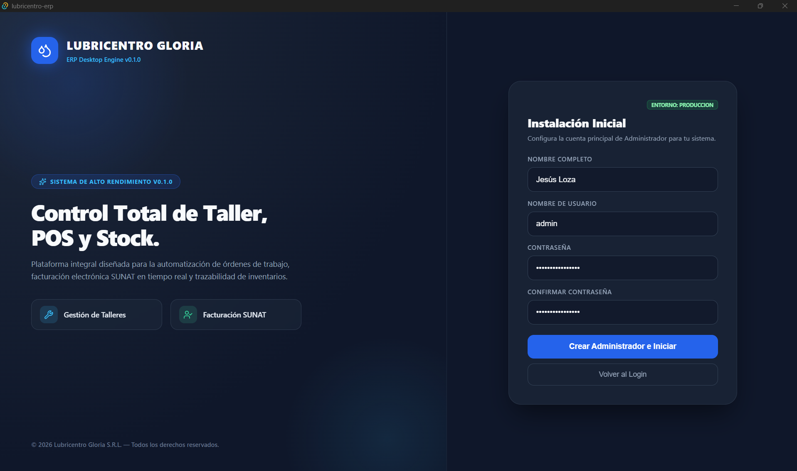

_Cambio de contraseña_

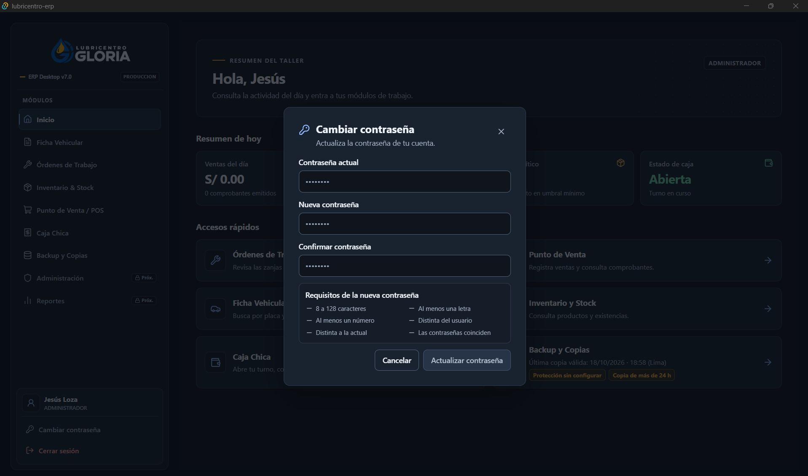

**Pendiente para cerrar:**

- Mostrar un error claro y permitir reintentar si falla la comprobación inicial de instalación.
- Activar el aviso de captura pendiente únicamente cuando existan modificaciones sin guardar.
- Completar evidencia de navegación por teclado, recorridos en escritorio y mediciones de tiempo de ingreso exigidas.

**Estado:** **95/100 en la última revisión**, con ajustes y validación de escritorio pendientes antes del cierre.

</details>

<a id="modulo-ficha-vehicular-e-historial"></a>

<details>
<summary><b>02 · Ficha Vehicular e Historial</b> — 🟢 Ajustes finales · Evaluación: 93/100</summary>

**Qué hace:** centraliza la identificación del vehículo, su propietario y las atenciones realizadas. Permite consultar la ficha y mantener sus datos relacionados con las órdenes del taller.

**Funciones principales:**

- **Buscar vehículos:** normaliza la placa y muestra vehículo, propietario, kilometraje y estado; permite limpiar la selección y reintentar consultas fallidas.
- **Registrar clientes y vehículos:** admite clientes sin vehículo, reutiliza clientes existentes y permite el registro conjunto de forma atómica.
- **Editar información:** administrador y cajero modifican datos comunes; cambiar placa, propietario o reducir kilometraje exige administrador y motivo.
- **Desactivar y reactivar:** conserva el historial, bloquea la desactivación si existe una OT abierta e impide recibir en Taller un vehículo inactivo.
- **Consultar mantenimientos:** muestra OT finalizadas, aunque estén pendientes de cobro, con **20 registros por página**, servicios, insumos, resumen, kilometraje, aceite y cliente histórico. «Ver atención» abre el detalle completo.
- **Corregir datos públicos:** el administrador puede ajustar kilometraje de atención, resumen o aceite cuando corresponde; la atención queda marcada como corregida y se registra auditoría.
- **Consultar próximos cambios:** búsqueda por placa o cliente, filtros por kilometraje, fecha o ambos, teléfono y acceso a la ficha. No registra llamadas ni oculta candidatos.
- **Abrir recepción:** lleva el vehículo seleccionado al formulario de OT y comprueba su actividad y la existencia de otra orden abierta.

**Fortalezas de implementación:**

- Historial vinculado al **ID del vehículo**: corregir la placa no desvincula las atenciones anteriores.
- Respuestas públicas específicas, sin notas técnicas ni costos; el mecánico tampoco recibe contactos del propietario.
- Paginación, filtros y conteos en SQLite, con orden definido.
- Restricciones persistentes, transacciones y auditoría para altas y cambios administrativos.
- Corregir una atención no modifica automáticamente el kilometraje actual ni mueve stock o dinero.
- **16 pruebas de vehículos aprobadas** en la última revisión reportada, además de comprobaciones adicionales de las correcciones recientes.

**Acceso por rol:**

| Rol           | Alcance                                                                                                                          |
| ------------- | -------------------------------------------------------------------------------------------------------------------------------- |
| Administrador | Gestión de ficha, cambio de placa o propietario, reducción de kilometraje, correcciones y desactivación/reactivación con motivo. |
| Cajero        | Registro, edición de datos comunes y consulta autorizada.                                                                        |
| Mecánico      | Consulta de información pública del vehículo y sus atenciones, sin contactos del propietario.                                    |

**Capturas:**

_Ficha vehicular principal_

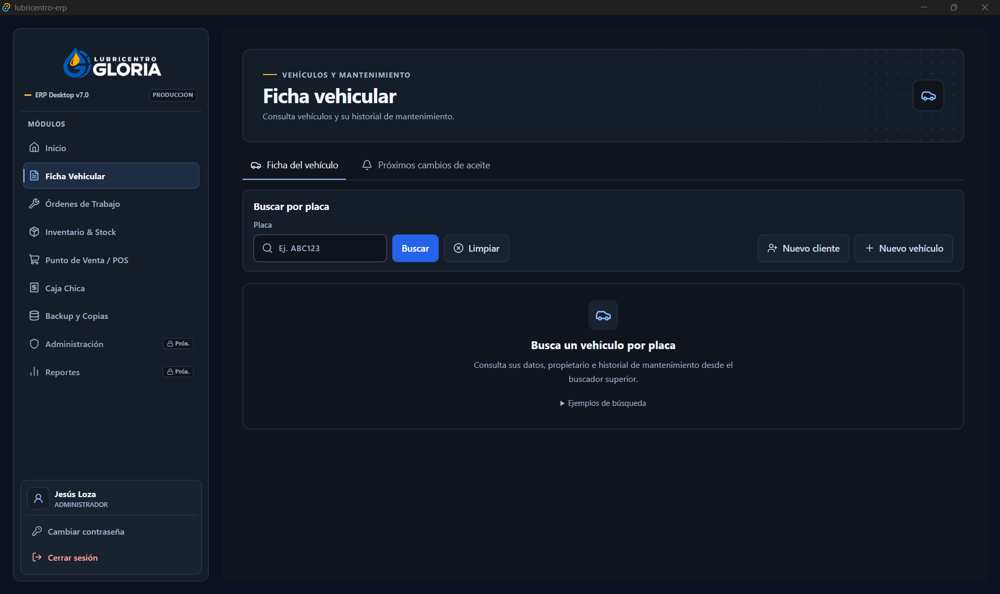

_Historial de atenciones_

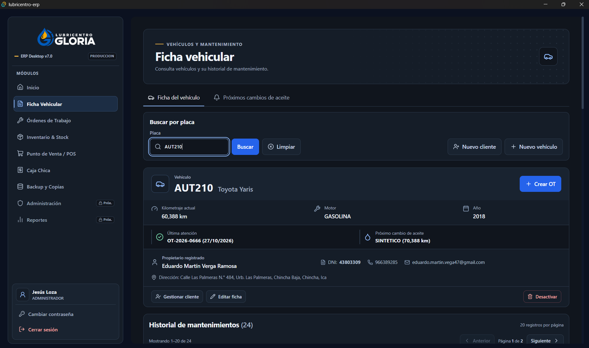

_Registro o edición del vehículo_

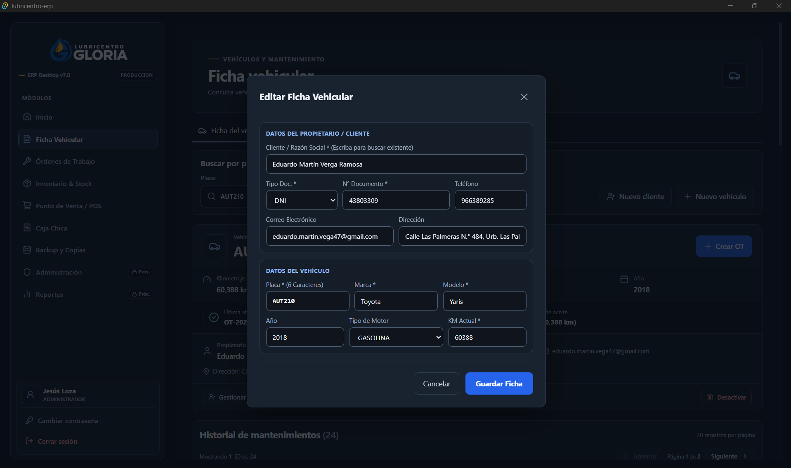

_Próximos cambios de aceite_

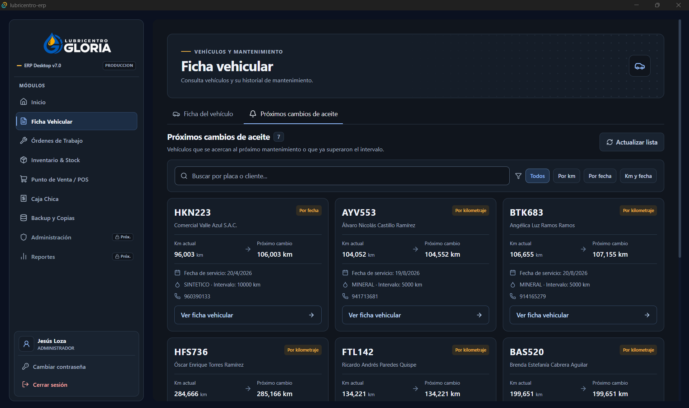

**Pendiente para cerrar:**

- Activar el indicador de captura pendiente al modificar datos, no al abrir el formulario.
- Incorporar a las pruebas permanentes los casos recientes de filtros, paginación, resumen y recepción.
- Completar los recorridos en escritorio y las cinco mediciones con el volumen de prueba definido.

**Estado:** **93/100 en la última revisión**. Las funciones principales están alineadas; el cierre se concentra en precisión de estados, tratamiento de errores y evidencia de validación.

</details>

<a id="modulo-ordenes-de-trabajo-taller"></a>

<details>
<summary><b>03 · Órdenes de Trabajo Taller</b> — 🟢 Ajustes finales · Evaluación: 93/100</summary>

**Qué hace:** organiza la atención del vehículo desde la recepción hasta la finalización o cancelación. Reúne servicios, responsable, zanja, materiales y resultado del trabajo, vinculados con Ficha Vehicular e Inventario.

**Funciones principales:**

- **Recepcionar vehículos:** selecciona un vehículo activo, registra kilometraje, pedido y servicio inicial; permite elegir mecánico o dejar la orden libre, evitando otra OT abierta para el mismo vehículo.
- **Consultar el tablero:** muestra primero las zanjas habilitadas y su ocupación, seguidas de una cola común de espera compacta. El mecánico consulta propias y libres; los trabajos ajenos se presentan sin información privada.
- **Buscar y listar órdenes:** ofrece páginas de **20 registros**, búsqueda por placa o código, filtros por estado, responsable y fechas, además de vistas de propias y libres. Propone la fecha de Lima y limita el rango a 366 días.
- **Iniciar trabajo:** exige una zanja habilitada y libre. El mecánico que inicia una orden libre queda asignado en la misma operación; el administrador selecciona responsable cuando falta.
- **Reasignar responsable:** el administrador puede cambiar al mecánico con motivo, conservando el creador y los datos originales.
- **Gestionar servicios:** administrador y mecánico propietario pueden agregar, modificar cantidades o retirar servicios mientras la OT esté abierta, manteniendo al menos uno. Los repetidos aumentan su línea al precio histórico.
- **Editar la nota interna:** permite una observación privada por orden, editable por administrador o mecánico responsable mientras esté abierta; queda separada del resumen público.
- **Registrar consumos:** descuenta materiales realmente utilizados durante la ejecución, conserva cantidades, precios y costos históricos y genera su movimiento de inventario.
- **Devolver materiales recuperados:** el administrador registra cantidad y motivo, sin superar el consumo neto; repone stock al costo de origen y conserva el retiro original.
- **Finalizar la atención:** propone kilometraje y resumen de servicios; registra aceite cuando corresponde, calcula próximo cambio, actualiza Ficha y libera la zanja.
- **Cancelar una orden:** el administrador confirma con motivo. Libera la zanja, conserva el consumo neto como costo interno y no devuelve stock automáticamente ni modifica el kilometraje del vehículo.
- **Recibir avisos de resultado:** muestra éxito después de confirmar el guardado y la causa de los rechazos, con el mismo componente de avisos de Ficha Vehicular. Los errores permanecen en el formulario y conservan lo escrito; si falla la recarga después de guardar, lo informa sin pedir repetir la operación.

**Fortalezas de implementación:**

- Validaciones de sesión, rol, responsable y estado desde Rust.
- Restricciones persistentes para una OT abierta por vehículo y una en proceso por zanja.
- Transacciones para mantener consistentes estado, inventario y kilometraje.
- Auditoría transaccional de recepción, inicio, nota, reasignación, finalización y cancelación.
- Privacidad según rol y propietario: cajero sin notas ni costos; mecánico sin notas ajenas ni costos internos.
- Cantidades de granel almacenadas en mililitros, con conversión y valoración verificadas.
- Identificador de operación en consumos y devoluciones: el backend evita repetir efectos cuando recibe el mismo identificador. Su conservación al reintentar desde la interfaz sigue pendiente.
- Modal organizado en hook, contenedor y componentes de acciones, servicios e insumos.
- **13 pruebas de Órdenes aprobadas** en la última revisión reportada, además de comprobaciones adicionales de auditoría, reversión e identificadores repetidos.

**Acceso por rol:**

| Rol           | Alcance                                                                                                                                                                                   |
| ------------- | ----------------------------------------------------------------------------------------------------------------------------------------------------------------------------------------- |
| Administrador | Recepción y gestión del taller; asignación y reasignación, notas, servicios, consumos, devolución de materiales y cancelación con motivo.                                                 |
| Mecánico      | Consulta de propias y libres; inicio de las permitidas y ejecución de sus órdenes. Gestiona servicios y nota interna en las condiciones autorizadas, sin costos internos ni notas ajenas. |
| Cajero        | Recepción y consulta pública autorizada, sin notas internas ni costos ni operaciones de ejecución reservadas.                                                                             |

**Capturas:**

_Tablero: zanjas y cola de espera_

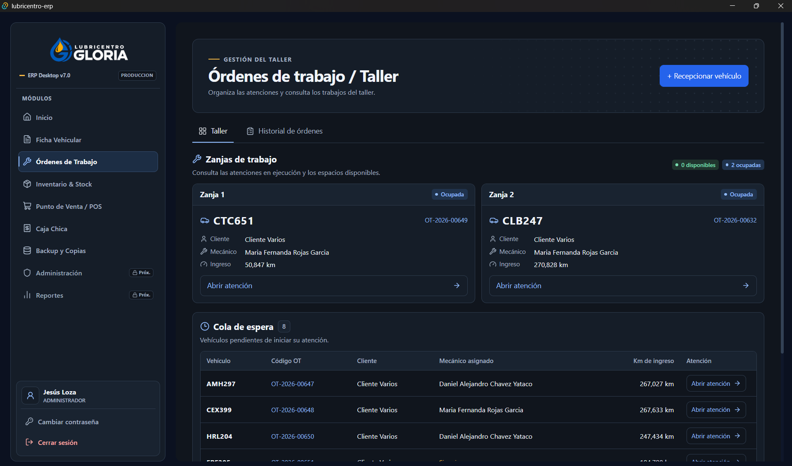

_Recepción del vehículo_

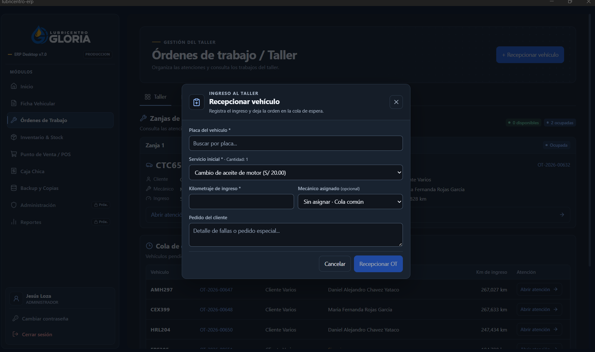

_Detalle: acciones, servicios e insumos_

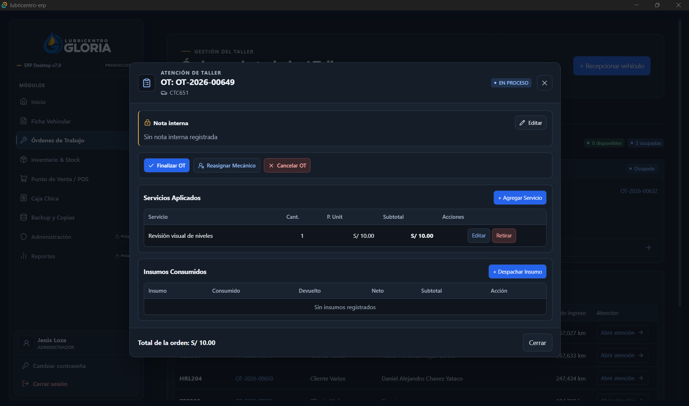

_Historial y filtros_

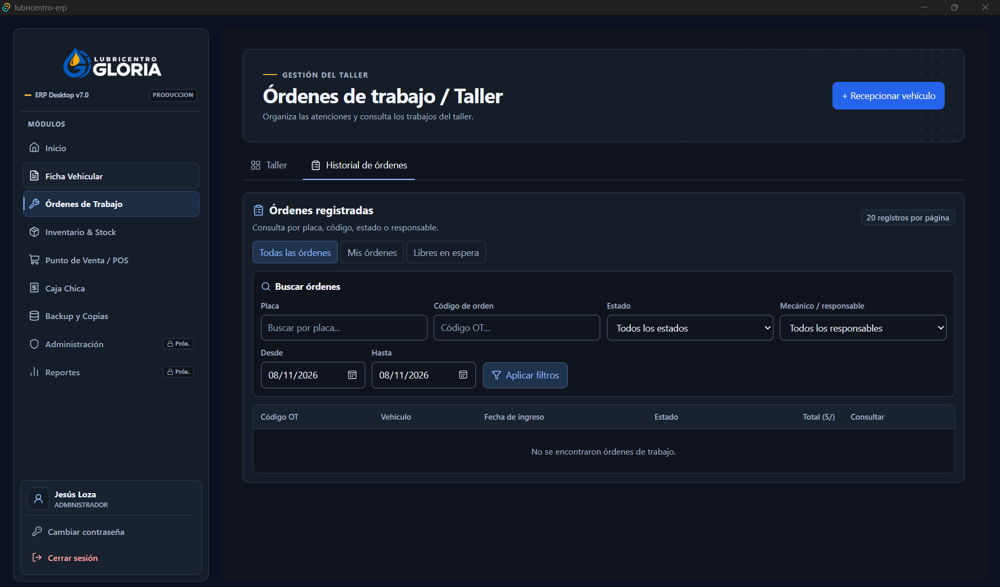

_Aviso de resultado de una operación_

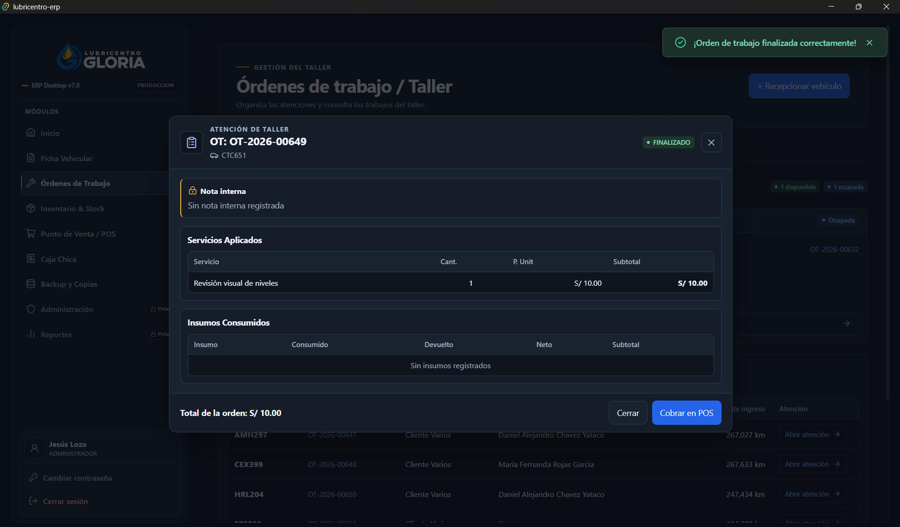

**Pendiente para cerrar:**

- Conservar el mismo identificador al reintentar un retiro o devolución tras una respuesta incierta; la protección de Inventario no se aplica automáticamente a estos formularios.
- Completar la auditoría de agregar, modificar y retirar servicios de la OT, con pruebas permanentes de reintentos y reversión ante fallos.
- Completar los recorridos en escritorio y las cinco mediciones con **2.000 OT**.

**Estado:** 🟢 **Ajustes finales · Evaluación: 93/100**. El ciclo principal del taller está implementado y mantiene su integración con Ficha e Inventario. El cierre se concentra en reintentos desde la interfaz, auditoría de servicios y evidencia de validación.

</details>

<a id="modulo-inventario-y-stock"></a>

<details>
<summary><b>04 · Inventario y Stock</b> — 🟢 Ajustes finales · Evaluación: 95/100</summary>

**Qué hace:** administra los productos, servicios y proveedores del lubricentro. Controla las existencias, las entradas de mercadería y su valoración, compartiendo el saldo con las órdenes del taller y conservando la trazabilidad de los movimientos.

**Funciones principales:**

- **Consultar productos:** permite buscar por código o nombre, filtrar por categoría y disponibilidad, y consultar **20 registros por página**. El administrador también puede consultar productos inactivos.
- **Identificar stock crítico:** muestra productos activos cuyo stock es menor o igual al mínimo, incluye el faltante individual y prioriza los productos sin existencias.
- **Registrar productos:** propone un código y un mínimo de cero. Permite incorporar existencias iniciales con su costo de adquisición; producto, entrada inicial y movimiento se guardan juntos, con referencia automática.
- **Editar y cambiar estado:** el administrador mantiene los datos del catálogo y desactiva o reactiva con motivo. Se conserva el historial y se bloquea la desactivación cuando existe consumo neto en una OT abierta.
- **Administrar servicios:** permite registrar y editar servicios, establecer precios y señalar cuáles corresponden a cambio de aceite. Los servicios no tienen stock ni descuentan aceite automáticamente.
- **Gestionar proveedores:** permite registrar, buscar, editar y reutilizar proveedores desde Entradas o crearlos durante una compra. Admite DNI, RUC y CE, además de contactos opcionales.
- **Registrar compras recibidas:** incorpora múltiples productos con cantidades y costos por unidad o litro, proveedor y documento opcional. Guarda todas las líneas o ninguna y actualiza la valoración sin registrar pagos de caja.
- **Consultar entradas:** muestra ingresos iniciales y compras, sus detalles y estado, con filtros por origen, estado y fechas. Permite anular con motivo únicamente cuando no existen movimientos posteriores de sus productos.
- **Revisar el kardex:** presenta entradas, salidas, cantidades, costos, valores y responsables. Distingue saldo inicial del período, saldo final y saldo actual, y permite consultar el origen del movimiento.
- **Realizar conteos físicos:** compara la cantidad física total con el saldo registrado y calcula la diferencia. Sin diferencias no genera movimiento ni exige motivo; con diferencias registra el ajuste autorizado.
- **Recuperar solicitudes inciertas:** conserva el identificador y los datos originales de compras, conteos, ajustes y anulaciones para reintentar sin duplicar efectos. El caso particular del conteo sin diferencias se detalla entre los pendientes.
- **Recibir avisos de resultado:** presenta mensajes de éxito tras confirmar una operación y errores en el formulario correspondiente, conservando los datos para corregir o reintentar, con el estilo de Ficha Vehicular y Taller.

**Fortalezas de implementación:**

- **Permisos comprobados en Rust:** costos, valoración, proveedores, entradas y kardex quedan restringidos al administrador; los roles de consulta reciben respuestas públicas específicas, sin costos ni valor de stock.
- **Transacciones y auditoría:** los movimientos, las cantidades, los valores y sus registros relacionados se confirman juntos; los fallos revierten la operación.
- **Unidades diferenciadas:** productos comunes utilizan UND; granel se muestra en litros y se almacena en mililitros, con validación de precisión.
- **Valoración e historial:** calcula el promedio de adquisición, conserva los costos históricos de las salidas y deja cantidad y valor en cero al agotar existencias.
- **Reintentos protegidos:** la interfaz persiste las solicitudes por usuario y ambiente; el backend reconoce operaciones confirmadas y rechaza reutilizar un identificador con datos diferentes.
- **Consultas consistentes:** paginación y filtros en SQLite, orden definido y protección frente a respuestas antiguas en las consultas principales.
- **Validación ampliada:** las **13 pruebas nuevas de cierre de inventario pasaron** en la última revisión, además de las pruebas existentes de inventario, idempotencia e integración con Taller.
- **Rendimiento del backend comprobado:** cinco muestras con **1.000 productos y 10.000 movimientos** registraron aproximadamente **0,2 a 1,8 ms** en catálogo, críticos y kardex utilizando SQLite en memoria. Falta medir el recorrido completo en escritorio.

**Acceso por rol:**

| Rol           | Alcance                                                                                                                                                                               |
| ------------- | ------------------------------------------------------------------------------------------------------------------------------------------------------------------------------------- |
| Administrador | Gestión de productos, servicios y proveedores; compras, entradas, costos, valoración, kardex, conteos y cambios de estado o anulaciones con motivo.                                   |
| Mecánico      | Consulta autorizada de productos y servicios activos, stock y precios de venta; sin costos, valoración ni operaciones administrativas. Los consumos del taller se registran desde OT. |
| Cajero        | Consulta autorizada de productos y servicios activos, stock y precios de venta; sin costos, valoración ni operaciones administrativas de Inventario.                                  |

**Capturas:**

_Catálogo de productos, filtros y existencias_

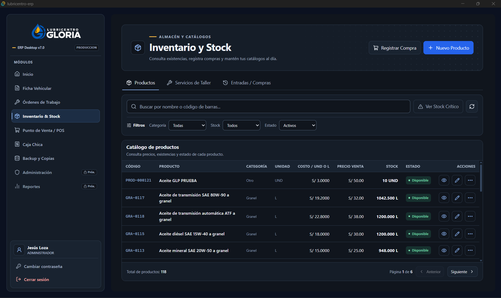

_Servicios del taller_

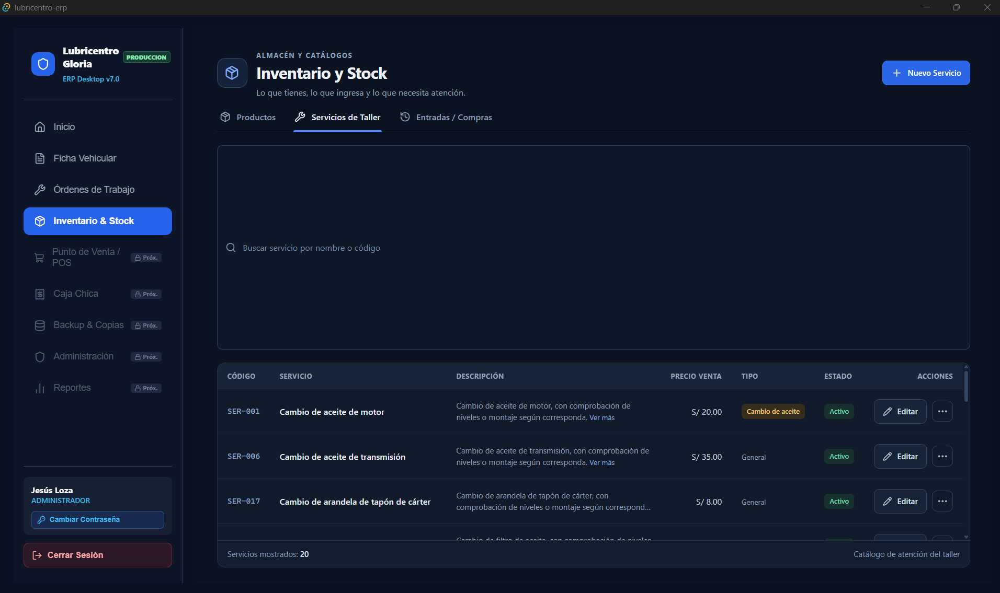

_Entradas, compras y acceso a proveedores_

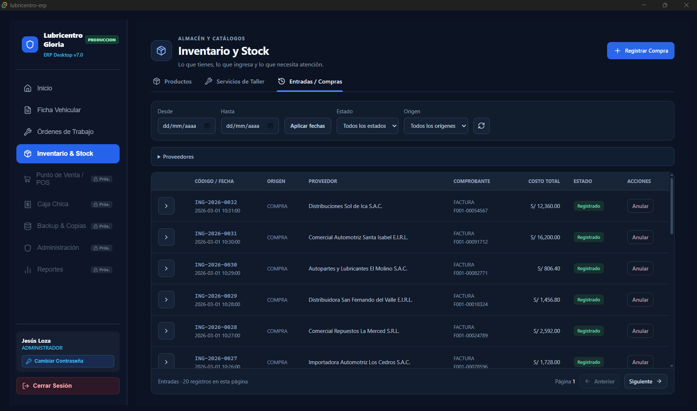

_Registro o edición de un producto_

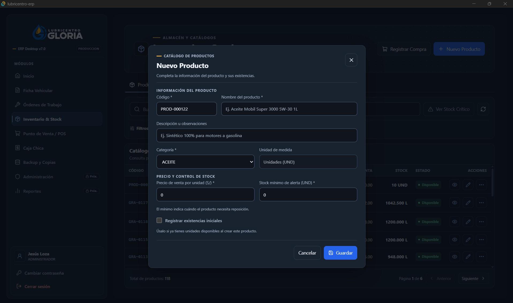

_Registro de compra recibida_

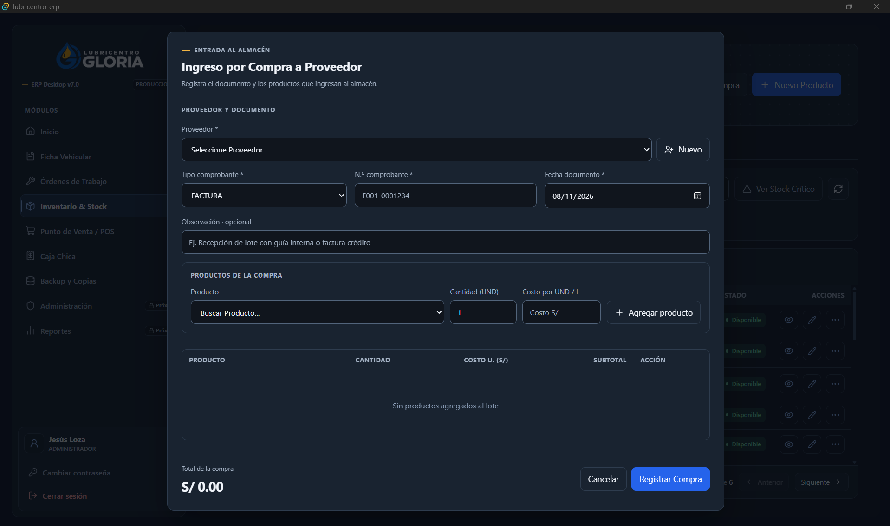

_Conteo físico y diferencia de existencias_

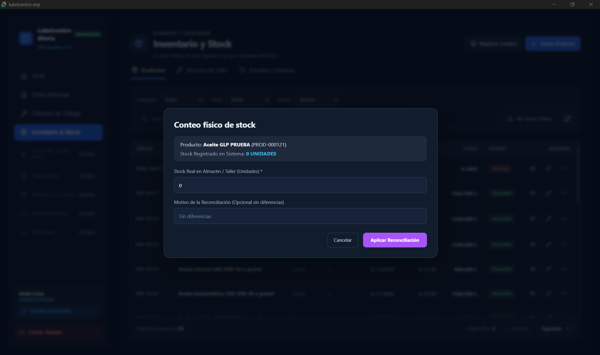

_Kardex y origen de movimientos_

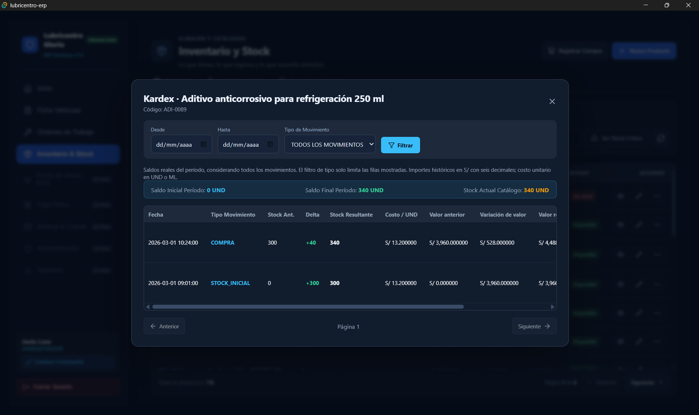

_Aviso de resultado de una operación_

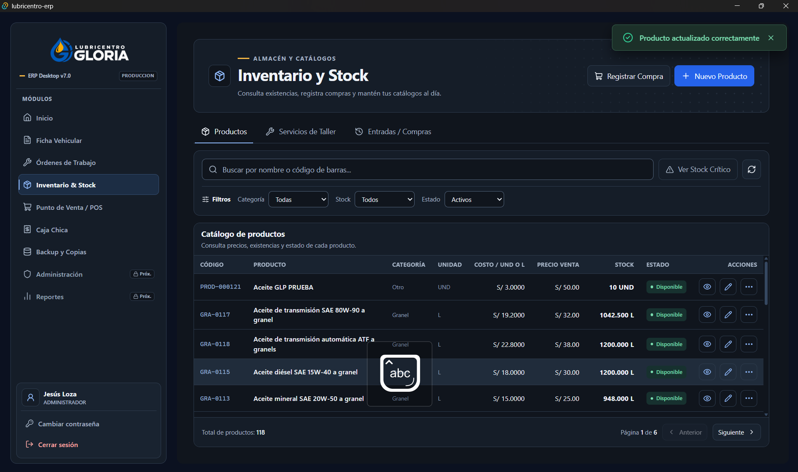

**Pendiente para cerrar:**

- Permitir un sobrante desde stock cero utilizando el costo previo, sin que el formulario obligue indirectamente a capturar otro importe.
- Dar prioridad al último costo válido cuando existe; solicitar un costo nuevo únicamente cuando no haya antecedente.
- Permitir recuperar un conteo sin diferencias cuya respuesta fue incierta, aunque después haya cambiado el saldo.
- Confirmar el descarte al abandonar formularios modificados e integrar el indicador global de captura pendiente.
- Deshabilitar y mostrar el procesamiento del botón Guardar producto durante el envío.
- Incorporar los casos adicionales detectados a las pruebas permanentes y completar los recorridos y mediciones con SQLite en disco y la aplicación de escritorio.

**Estado:** 🟢 **Ajustes finales · Evaluación: 95/100**. Las funciones principales están ampliamente alineadas con el PDF. El cierre se concentra en casos particulares del conteo, protección de formularios y evidencia de validación en escritorio.

</details>

<a id="modulo-punto-de-venta-pos"></a>

<details>
<summary><b>05 · Punto de Venta POS</b> — 🟢 Ajustes finales · Evaluación: 95/100</summary>

**Qué hace:** permite vender productos y servicios, cobrar órdenes de trabajo finalizadas y registrar devoluciones. Vincula venta, pagos, caja, inventario y comprobantes electrónicos, conservando los datos históricos de cada operación.

**Funciones principales:**

- **Preparar ventas directas:** busca productos y servicios activos por código o nombre. Permite modificar cantidades, retirar líneas y vaciar el carrito. Valida de **1 a 99.999 unidades por línea directa en UND**, incluidos los servicios.
- **Cobrar órdenes finalizadas:** el selector muestra código, placa, cliente, fecha de finalización y total histórico. Las líneas de la OT son de solo lectura y conservan sus precios; se pueden agregar productos o servicios directos sin volver a descontar los insumos consumidos en Taller.
- **Seleccionar receptor:** permite reutilizar un cliente o registrar uno sin vehículo. Admite Cliente varios cuando corresponde y valida identificación y dirección según el comprobante.
- **Emitir boleta o factura:** guarda receptor, líneas, importes, serie y número junto con la venta. El envío electrónico se realiza después de confirmar la operación local.
- **Aplicar descuentos:** distribuye el porcentaje global entre las líneas. Hasta **5 %** no exige motivo; por encima requiere motivo y, para el cajero, autorización administrativa.
- **Registrar pagos:** admite uno o dos medios distintos entre Efectivo, Tarjeta, Yape, Plin y Transferencia. Propone el total y el restante, calcula vuelto y registra los importes aplicados.
- **Consultar ventas:** ofrece un listado paginado con filtros de fecha, número o cliente y estado electrónico. El administrador también puede filtrar por emisor y documentos con problemas; el cajero solo consulta sus propias ventas.
- **Registrar devoluciones:** un mismo formulario admite devoluciones parciales y totales, calcula lo pendiente y permite seleccionarlo todo. La cantidad recuperable empieza en cero y solo retorna al inventario el material recibido físicamente.
- **Gestionar comprobantes:** conserva los estados pendiente, error, aceptado y rechazado. El administrador puede revisar hasta **20 pendientes por acción**, consultar el documento original antes de reenviarlo y reemitir rechazos con otro número vinculado.
- **Reimprimir y consultar archivos:** reutiliza la venta existente para el ticket y permite abrir PDF, XML y CDR cuando están disponibles. Las observaciones se muestran sin cambiar el estado **Aceptado**.
- **Recuperar solicitudes inciertas:** conserva el identificador y los datos originales para recuperar el resultado sin repetir el cobro, la devolución ni la reemisión.

**Fortalezas de implementación:**

- **Confirmación atómica:** venta, líneas, pagos, caja, stock directo, numeración, documento pendiente y auditoría se guardan en una transacción.
- **Idempotencia persistente:** repetir la misma solicitud recupera su resultado; reutilizar el identificador con otros datos se rechaza.
- **Permisos en Rust:** exige sesión operativa y caja propia para cobrar o reintegrar. El mecánico no accede al POS y el cajero no recibe costos ni ventas ajenas.
- **Autorización con trazabilidad:** el cajero sigue siendo el ejecutor y titular de la caja; el administrador queda registrado como autorizante.
- **Cálculos deterministas:** dinero en céntimos, granel en mililitros y distribución controlada de descuentos, impuestos y diferencias de redondeo de las devoluciones.
- **Historial protegido:** editar el catálogo no reescribe líneas confirmadas. Cobrar una OT no repite el consumo ni reabre el trabajo.
- **Recuperación documental comprobada localmente:** una prueba cierra y reabre SQLite y comprueba que el intento interrumpido obliga a consultar antes de reenviar.
- **20 pruebas de la suite de POS en Rust aprobadas**, incluida la integración con Caja Chica, además de pruebas de interfaz y recuperación documental.
- **Rendimiento del backend comprobado:** cinco muestras con **5.000 ventas en SQLite temporal en disco** promediaron **44,76 ms** en listado y **7,46 ms** en confirmación local. Todas quedaron por debajo de tres segundos. Falta medir el recorrido completo en escritorio.

**Acceso por rol:**

| Rol           | Alcance                                                                                                                                                 |
| ------------- | ------------------------------------------------------------------------------------------------------------------------------------------------------- |
| Administrador | Consulta general, cobros y reintegros con caja propia, autorización de excepciones y gestión de comprobantes pendientes o rechazados.                   |
| Mecánico      | Sin acceso al POS.                                                                                                                                      |
| Cajero        | Ventas y consultas propias, cobros y reintegros con caja propia; autorización administrativa cuando corresponde y sin acceso a costos ni ventas ajenas. |

**Capturas:**

_Pantalla principal del POS: catálogo y carrito de venta_

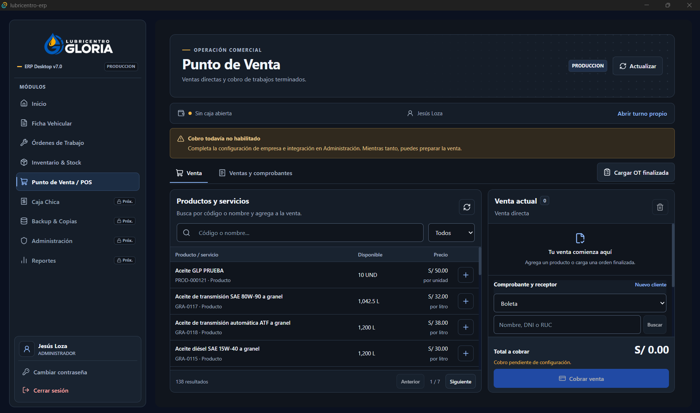

Quedan por añadir las capturas de selección de OT, cobro, devolución y detalle de comprobante cuando se documenten esos recorridos en escritorio.

**Pendiente para cerrar:**

- Mostrar en el detalle la fecha y hora del último intento documental, que ya se guardan.
- Completar las pruebas de transporte HTTP: conexión, credenciales y respuestas del servidor.
- Validar la integración completa en el ambiente de Prueba de NubeFact, incluidos la emisión, la consulta y el acceso a sus archivos oficiales.
- Comprobar la impresión real, los tickets largos, los fallos de impresora y la reimpresión.
- Completar los recorridos en Tauri con teclado, descarte de capturas, vencimiento de sesión y recuperación de solicitudes.
- Comprobar la zona horaria y los casos de medianoche, y medir los tiempos desde la acción del usuario hasta la presentación en WebView.

**Estado:** 🟢 **Ajustes finales · Evaluación: 95/100**. Las funciones económicas principales están implementadas y respaldadas por pruebas. El cierre se concentra en la información documental, la integración externa y la validación completa en escritorio.

</details>

<a id="modulo-caja-chica"></a>

<details>
<summary><b>06 · Caja Chica</b> — 🟢 Ajustes finales · Evaluación: 94/100</summary>

**Qué hace:** controla los turnos de caja, el efectivo disponible y los movimientos de ventas, devoluciones e ingresos o egresos manuales. Permite cerrar cada turno comparando el efectivo esperado con el contado y conservar su historial.

**Funciones principales:**

- **Abrir turno propio:** registra el fondo inicial, sugiere el fondo reservado en el cierre anterior e impide abrir otro turno si hay uno activo. Cambiar de usuario no transfiere ni cierra el turno.
- **Consultar saldos:** desglosa el efectivo esperado y presenta por separado los totales de Tarjeta, Yape, Plin y Transferencia. Los pagos digitales no aumentan el efectivo disponible.
- **Integrar cobros y devoluciones del POS:** los movimientos quedan en el turno del usuario que realiza la operación. En un pago mixto solo se contabiliza el efectivo aplicado; el dinero recibido y el vuelto no vuelven a sumarse.
- **Registrar movimientos manuales:** admite ingresos y egresos en efectivo con categoría, concepto y límites de importe. Verifica la disponibilidad antes de registrar una salida.
- **Revertir movimientos manuales:** conserva el original y registra su inverso con motivo obligatorio. Impide repetir la reversión y comprueba el saldo si el inverso retira efectivo.
- **Cerrar con arqueo:** solicita el efectivo contado, calcula la diferencia y exige motivo desde un céntimo de diferencia. Permite reservar un fondo para el siguiente turno y calcula el retiro sin registrar otro egreso.
- **Detectar cambios durante el arqueo:** si se registra un movimiento después de consultar el resumen, exige revisar los nuevos importes y conserva el conteo introducido.
- **Consultar historial y movimientos:** ofrece filtros, búsqueda y **20 registros por página**. Permite abrir el detalle del turno y acceder a las ventas relacionadas según los permisos de POS. El historial conserva las cifras del cierre.
- **Realizar cierres administrativos:** el administrador puede cerrar por ausencia o cerrar un turno recuperado, con motivo obligatorio.
- **Agregar aclaraciones:** el administrador puede registrar o editar una aclaración del cierre con autor, fecha y auditoría. Los importes guardados no cambian.
- **Proteger la información y preparar la impresión:** el cajero solo consulta sus turnos; ante un turno ajeno recibe el aviso de ocupación. El administrador puede consultar los cierres autorizados y preparar su impresión.

**Fortalezas de implementación:**

- **Precisión monetaria:** los importes se almacenan en céntimos enteros.
- **Guardado atómico:** la operación, su auditoría y su resultado se guardan en una sola transacción.
- **Reintentos sin duplicados:** los identificadores persistentes permiten recuperar el resultado de una solicitud incierta.
- **Permisos en Rust:** el backend valida la sesión, el rol y el usuario responsable de la operación.
- **Control de versión del arqueo:** impide cerrar con un resumen desactualizado.
- **Organización del código:** separa consultas, escrituras, formularios y presentación.
- **Cobertura automatizada:** **4 pruebas Rust y 3 pruebas de interfaz propias de Caja Chica aprobadas**, además de la prueba de integración con POS y dos comprobaciones temporales adicionales reportadas en la revisión.
- **Caso del PDF verificado con el POS real del ERP:** **S/ 330 esperados**, **S/ 324 contados**, diferencia de **−S/ 6** y retiro de **S/ 224**, tras reservar **S/ 100**.
- **Rendimiento del backend comprobado:** con **5.000 turnos y 100.000 movimientos** en SQLite temporal en disco, las **20 muestras** de cada operación medida —resumen, primera página de movimientos y cierre— quedaron por debajo de **2 segundos**, según la última revisión.

**Acceso por rol:**

| Rol           | Alcance                                                                                                                          |
| ------------- | -------------------------------------------------------------------------------------------------------------------------------- |
| Administrador | Opera su turno, consulta otros turnos, realiza cierres por ausencia o recuperación y añade aclaraciones.                         |
| Mecánico      | Sin acceso a Caja Chica.                                                                                                         |
| Cajero        | Abre, opera y cierra su propio turno; consulta sus movimientos y cierres. Si hay un turno ajeno, solo ve el estado de ocupación. |

**Capturas:**

Vistas de la interfaz con datos ficticios en ambiente de demostración.

_Mi caja: efectivo, pagos digitales y movimientos del turno_

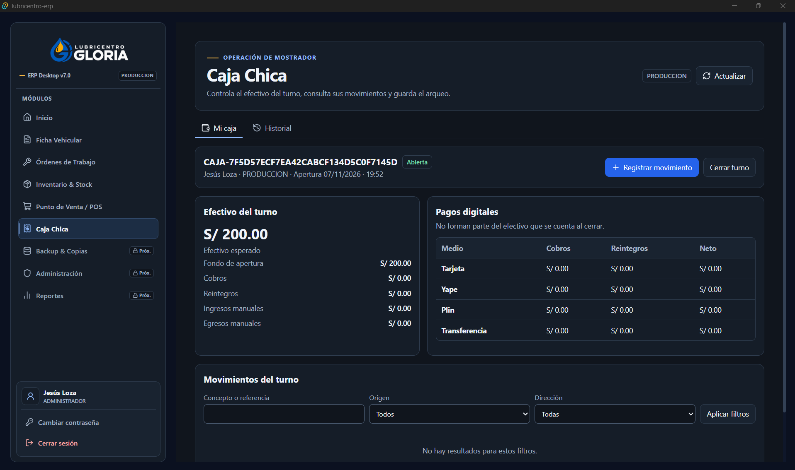

_Historial de turnos: filtros y cierres registrados_

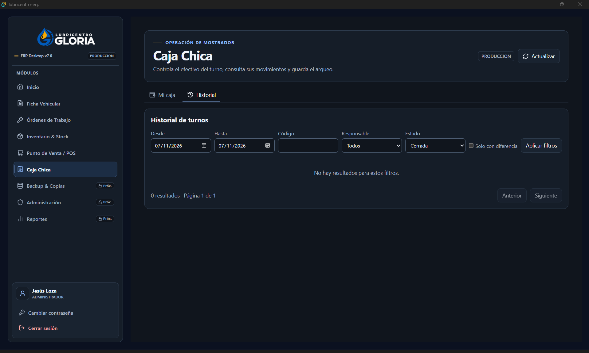

**Pendiente para cerrar:**

- Corregir la respuesta tardía al volver al historial: si se actualiza un detalle y se regresa antes de recibir la respuesta, esta puede volver a abrirlo. El fallo se reprodujo sin observar alteración de importes.
- Incorporar ese caso a las pruebas permanentes y ampliar la cobertura de filtros, paginación, reversiones, aclaraciones e impresión.
- Completar los recorridos en Tauri: teclado, foco de diálogos, cambio de usuario, navegación entre Caja Chica y POS e impresión real.
- Comprobar operaciones alrededor de la medianoche en Lima y turnos que permanecen abiertos entre días.
- Medir el recorrido completo desde la interfaz de escritorio. La medición aprobada cubre el backend con SQLite temporal en disco.

**Estado:** 🟢 **Ajustes finales · Evaluación: 94/100**. Las reglas principales están implementadas y respaldadas por pruebas. Quedan la corrección de navegación, la ampliación de la cobertura de interfaz y la validación final en escritorio.

</details>

<a id="modulo-backup-y-copias"></a>

<details>
<summary><b>07 · Backup y Copias</b> — 🟢 Ajustes finales · Evaluación: 94/100</summary>

**Qué hace:** protege los datos del negocio mediante copias locales cifradas y verificadas. Permite guardar un respaldo fuera del equipo, restaurar los datos de una fecha anterior y completar la recuperación con controles de Caja, comprobantes y numeración.

**Funciones principales:**

- **Configurar la protección:** solicita una frase de 16 a 128 caracteres y su confirmación. Windows protege la frase local mediante DPAPI. Cancelar borra los campos sin guardar cambios.
- **Generar una copia manual:** toma una fotografía consistente de SQLite y de los archivos locales referenciados. Publica el respaldo tras verificarlo. Puede ejecutarse con un turno de Caja abierto.
- **Programar la copia diaria:** se ejecuta a las **23:00 de Lima** y contempla una ejecución pendiente si se omitieron días. Impide ejecutar dos tareas de Backup simultáneas.
- **Consultar respaldos:** muestra la última copia válida, la próxima diaria y su resultado. El historial permite filtrar por tipo y consultar **20 registros por página**. Identifica los archivos ausentes e impide seleccionarlos.
- **Seleccionar y comprobar:** abre el paquete en un espacio temporal sin sustituir los datos activos. Verifica autenticidad, esquema, empresa, ambiente, integridad de la base y archivos incluidos.
- **Guardar fuera del equipo:** guarda el mismo paquete con un nombre único en la carpeta o USB elegido y compara tamaño y huella. Si el guardado externo falla, conserva la copia local.
- **Conservar copias:** mantiene las últimas **14 copias rutinarias**, protege las previas y los archivos en uso y permite eliminar previas con autorización.
- **Restaurar información:** verifica los requisitos y el espacio disponible. Para sustituir una instalación existente exige cerrar el turno actual y genera una copia previa. Al terminar, requiere volver a iniciar sesión.
- **Completar la recuperación:** guía el cierre del turno recuperado, la configuración del token cuando falta y la conciliación de series. Conserva los máximos conocidos para impedir que la numeración retroceda.
- **Recuperar un arranque bloqueado:** permite volver mediante una copia previa registrada y verificada, con autenticación de un administrador incluido en ella. Evita crear silenciosamente una base vacía si falta la activa.
- **Mantener el contexto y mostrar el progreso:** conserva filtro, página y selección al volver desde Caja y revalida su vigencia. Muestra la etapa en curso y bloquea el cierre normal de la ventana durante el intercambio de la restauración.

**Fortalezas de implementación:**

- **Protección del paquete:** cifrado autenticado **AES-256-GCM** con clave derivada mediante **Argon2id**. La frase local se protege con DPAPI fuera de SQLite.
- **Fotografía consistente:** usa la **API de backup de SQLite** para incluir los cambios confirmados aunque la base use WAL. Comprueba integridad, relaciones, esquema y huellas.
- **Restauración por generaciones:** prepara la base y sus archivos como un conjunto, activa la nueva generación mediante un registro externo y conserva el conjunto anterior.
- **Permisos en Rust:** la gestión exige autorización administrativa. La selección se vincula al usuario, la sesión y su período de vigencia.
- **Coordinación con POS:** espera los envíos en curso y exige consultar los comprobantes recuperados con resultado incierto antes de reenviarlos.
- **Cobertura automatizada:** **10 pruebas de Rust y 6 de frontend aprobadas** en la última ejecución en Windows. Incluyen tres puntos de interrupción simulada, arranque con previa, archivos ausentes, referencias, retención y navegación desde Caja. La revisión anterior reportó inestabilidad de la suite de interfaz; queda por estabilizarla.
- **Conciliación comprobada en una revisión anterior:** una copia en **120** y un máximo conocido de **135** dieron **136** como siguiente número.
- **Rendimiento local:** en la revisión anterior, las **cinco muestras** con aproximadamente **100 MB de base y 100 MB de archivos** quedaron por debajo de **120 s** tanto al generar y verificar como al seleccionar y comprobar.

**Acceso por rol:**

| Rol           | Alcance                                                                                                 |
| ------------- | ------------------------------------------------------------------------------------------------------- |
| Administrador | Configura la protección, comprueba, exporta y restaura copias y completa los controles de recuperación. |
| Mecánico      | Sin acceso al módulo.                                                                                   |
| Cajero        | Sin acceso al módulo.                                                                                   |

La copia diaria se ejecuta como tarea del sistema. La recuperación de arranque exige las credenciales de un administrador incluido en la previa.

**Capturas:**

_Estado del respaldo: programación, conservación e historial de copias locales_

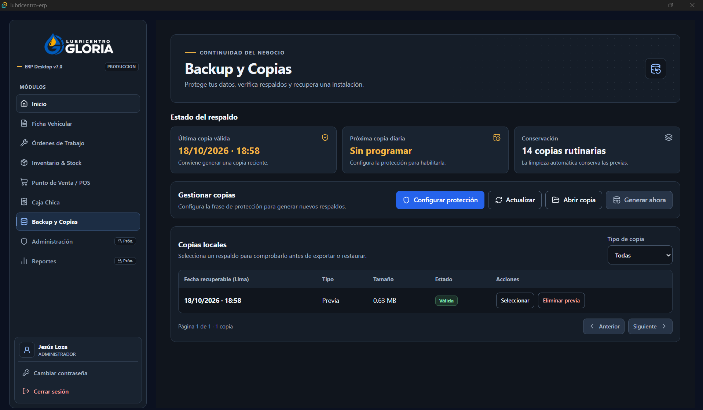

_Aviso en Inicio cuando no hay una copia válida reciente_

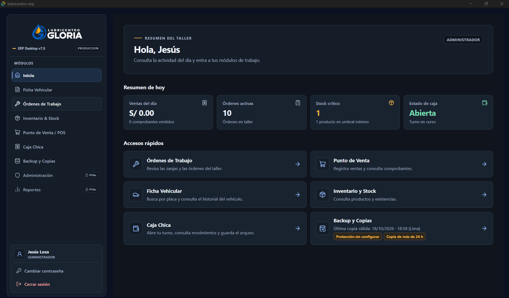

**Pendiente para cerrar:**

- Estabilizar las pruebas de frontend separando las consultas de progreso de las operaciones bajo prueba.
- Ampliar los escenarios de espacio insuficiente, fallo al crear la previa y desconexión del destino externo.
- Complementar las interrupciones simuladas con terminación y reapertura del proceso en Tauri, incluyendo archivos oficiales asociados.
- Ampliar las pruebas de la copia diaria: días omitidos, otra tarea en curso y fallo visible sin repetición indefinida.
- Ejecutar una recuperación completa en otro perfil o equipo Windows: Caja, token, series y retorno a POS.
- Completar los recorridos de teclado, selectores, progreso y bloqueo del cierre de ventana. Medir el guardado y la lectura desde USB por separado.

**Estado:** 🟢 **Ajustes finales · Evaluación: 94/100**. Los principales pendientes funcionales de la revisión anterior quedaron resueltos. Quedan por estabilizar las pruebas de interfaz y completar la evidencia de recuperación ante fallos y en escritorio.

</details>

<a id="modulo-administracion"></a>

<details>
<summary><b>08 · Administración</b> — 🟢 Ajustes finales · Evaluación: 96/100</summary>

**Qué hace:** gestiona las cuentas del equipo y la configuración del negocio desde cuatro pestañas: **Usuarios, Empresa, Facturación y Taller**. Permite administrar accesos, datos fiscales, credenciales, series y zanjas, además de cambiar entre Prueba y Producción.

**Funciones principales:**

- **Consultar usuarios:** permite buscar por login o nombre, filtrar por rol y estado y recorrer **20 registros por página**. Muestra si la cuenta está bloqueada o exige cambiar la contraseña. Conserva búsqueda, filtros y página al regresar desde Caja o Taller y recarga los resultados.
- **Crear cuentas:** normaliza el login, impide duplicados y asigna uno de los tres roles. Genera una contraseña temporal aleatoria de **12 caracteres**, visible solo durante la entrega, con cambio obligatorio al ingresar.
- **Editar accesos:** reúne nombre, rol y estado en un formulario. Exige un motivo cuando cambia el rol o el estado, y bloquea cambios incompatibles con turnos u OT pendientes.
- **Desbloquear, restablecer y reactivar:** desbloquear conserva la contraseña; restablecer genera otra temporal; reactivar conserva la contraseña y limpia el bloqueo. Protege la cuenta propia y evita dejar el sistema sin un administrador activo.
- **Mantener los datos de empresa:** registra datos fiscales, teléfono y correo, valida el ubigeo contra un catálogo local y muestra una vista previa. El RUC queda fijo tras el primer comprobante local de Producción. Los documentos anteriores conservan sus datos.
- **Configurar NubeFact:** guarda la ruta y protege el token por ambiente. Si el campo del token se deja vacío, conserva el vigente. Guardar la configuración no emite ni consulta comprobantes.
- **Gestionar series:** permite registrar, activar, desactivar y elevar el piso de numeración con referencia cuando corresponde. Calcula el siguiente número considerando los máximos locales, conservados y comprobados, sin reutilizar números pendientes o rechazados.
- **Ajustar zanjas:** permite configurar **de 1 a 6** posiciones, muestra su ocupación y bloquea retirar una posición ocupada. Conserva los identificadores históricos y la cola común de órdenes en espera.
- **Cambiar de ambiente:** verifica requisitos, prepara la base de destino y contempla un reinicio con un nuevo inicio de sesión. Los datos y las credenciales se mantienen separados entre Prueba y Producción.
- **Proteger capturas:** la X, Escape y Cancelar piden confirmación si hay cambios. Si se rechaza el descarte, el formulario conserva los valores. Los errores de ubigeo aparecen junto al campo sin borrar la captura.

**Fortalezas de implementación:**

- **Permisos en Rust:** valida la sesión y el rol administrativo en el backend, además de los controles de interfaz.
- **Protección de contraseñas:** usa **Argon2id** y entrega las claves temporales una sola vez. El texto de la clave no se registra en auditorías ni en resultados persistentes.
- **Integridad al guardar:** las transacciones, el control de versiones y la revalidación de dependencias previenen conflictos. Las pruebas comprobaron la reversión ante fallos de auditoría.
- **Integración con POS y Backup:** comparte los servicios de token y numeración usados en la emisión y en la recuperación.
- **Ubigeo sin internet:** valida contra **1.893 códigos distritales únicos**. El origen del catálogo está documentado en `UBIGEO.md`, junto al archivo de códigos.
- **Contexto por sesión:** vincula el listado a la sesión, usuario, rol y ambiente para no arrastrar filtros de otra sesión.
- **Cobertura automatizada:** **11 pruebas funcionales de Rust y 11 de frontend aprobadas** en Windows, además de la prueba de rendimiento ejecutada por separado.
- **Rendimiento:** con **200 cuentas y 20 series** en SQLite en memoria, las **20 muestras de cada operación** quedaron por debajo de **2 segundos**. Cargar la primera página y las series tomó **0,51–1,05 ms**; guardar una cuenta con cálculo del hash tomó **404–600 ms**.

**Acceso por rol:**

| Rol           | Alcance                                                                 |
| ------------- | ----------------------------------------------------------------------- |
| Administrador | Gestiona usuarios, empresa, facturación, taller y cambio de ambiente.   |
| Mecánico      | Sin acceso al módulo.                                                   |
| Cajero        | Sin acceso al módulo.                                                   |

**Capturas:**

_Listado de usuarios con filtros por rol y estado_

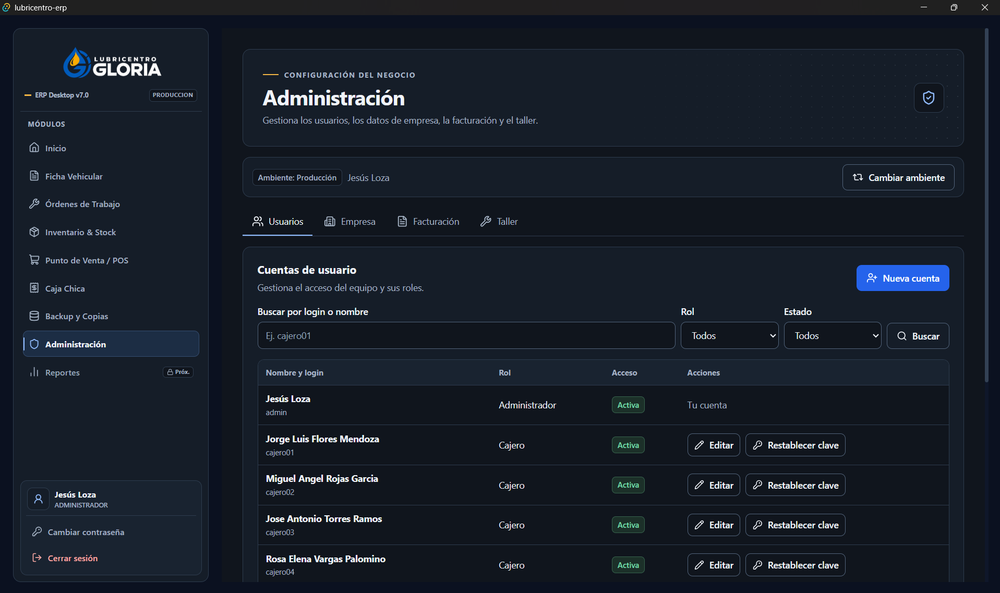

_Formulario de edición de una cuenta_

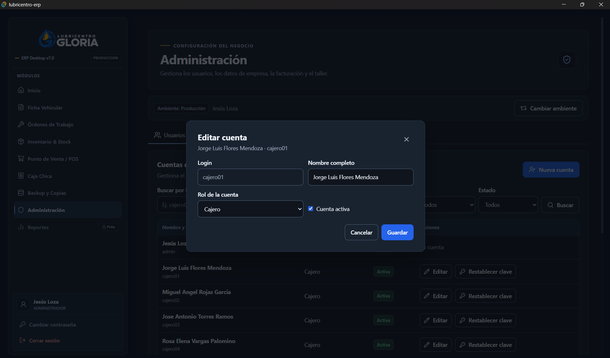

_Datos de empresa, contacto y ubigeo_

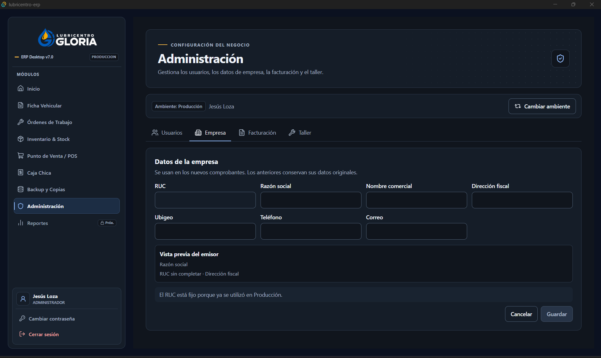

_Configuración de NubeFact y series de comprobantes_

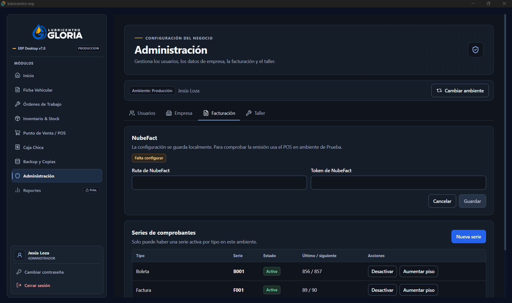

_Configuración y ocupación de zanjas del taller_

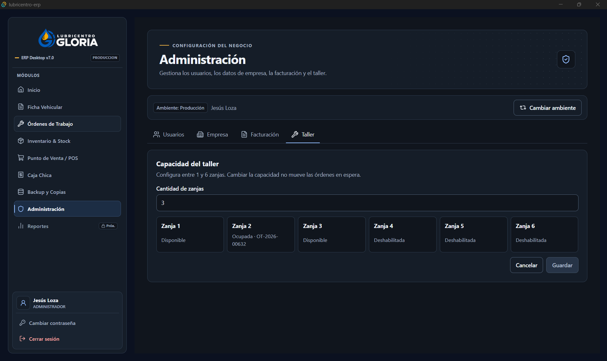

**Pendiente para cerrar:**

- Validar el cambio de ambiente en escritorio: reinicio, nuevo inicio de sesión, destino fallido y tareas incompatibles activas.
- Comprobar la configuración, el reemplazo y el fallo del token con el almacén de credenciales de Windows en un entorno aislado.
- Ejecutar el recorrido integrado: alta del trabajador, cambio de contraseña temporal, configuración, venta en POS de Prueba y recuperación desde Backup.
- Complementar el rendimiento con SQLite en disco y medir el recorrido de interfaz en el equipo de referencia.
- Completar las pruebas en Tauri de teclado, foco, mensajes y vencimiento de sesión durante una edición.
- Dejar una comprobación reproducible de procedencia e integridad para futuras actualizaciones del catálogo. El catálogo se cotejó con el endpoint oficial al incorporarlo; la última ejecución de pruebas en Windows no repitió ese cotejo.

**Estado:** 🟢 **Ajustes finales · Evaluación: 96/100**. Se corrigieron el descarte sin confirmación, la pérdida de filtros y la validación parcial de ubigeo. Los tres cambios cuentan con pruebas permanentes. El cierre se concentra en escritorio, el almacén de credenciales de Windows y los recorridos de integración.

</details>

<a id="modulo-reportes"></a>

**09 · Reportes — ⚪ Pendiente · Próximo módulo.** Integrará la consulta y la exportación autorizadas de información de los módulos anteriores. Todavía no tiene evaluación.

<a id="roles"></a>

## 4. Roles y permisos

| Módulo                      | Administrador                                                                       | Mecánico                                                                    | Cajero                                                                      |
| --------------------------- | ----------------------------------------------------------------------------------- | --------------------------------------------------------------------------- | --------------------------------------------------------------------------- |
| Login y Sesión              | Cuenta propia y gestión autorizada.                                                 | Cuenta propia.                                                              | Cuenta propia.                                                              |
| Ficha Vehicular e Historial | Gestión y correcciones autorizadas.                                                 | Consulta de información pública de atención.                                | Registro, edición de datos comunes y consulta.                              |
| Órdenes de Trabajo Taller   | Gestión del taller, reasignación, devolución y cancelación con motivo.              | Inicio de OT permitidas y ejecución de propias; sin notas ajenas ni costos. | Recepción y consulta pública; sin notas internas ni costos.                 |
| Inventario y Stock          | Catálogos, proveedores, entradas, costos, kardex y conteos.                         | Consulta de activos, stock y precios.                                       | Consulta de activos, stock y precios.                                       |
| Punto de Venta POS          | Cobros y reintegros con caja propia; consulta general y gestión documental.         | Sin acceso.                                                                 | Ventas propias, sin costos; autorización cuando corresponde.                |
| Caja Chica                  | Turno propio, consulta general, cierres por ausencia o recuperación y aclaraciones. | Sin acceso.                                                                 | Operación y consulta de turnos propios; solo ve ocupación en turnos ajenos. |
| Backup y Copias             | Configuración, copias y recuperación.                                               | Sin acceso.                                                                 | Sin acceso.                                                                 |
| Administración              | Usuarios, empresa, facturación y taller.                                            | Sin acceso.                                                                 | Sin acceso.                                                                 |
| Reportes                    | Consulta y exportación.                                                             | Sin acceso.                                                                 | Sin acceso.                                                                 |
| Inicio Dashboard            | Resumen del negocio.                                                                | Resumen de trabajos propios y disponibles.                                  | Resumen de caja y OT por cobrar.                                            |

Las autorizaciones se validan en Rust. Los costos y las notas internas se restringen por rol; ocultar botones no sustituye el control del backend.

<a id="flujo"></a>

## 5. Flujo de trabajo

| Paso                   | Acción                                                                | Resultado esperado                                                             |
| ---------------------- | --------------------------------------------------------------------- | ------------------------------------------------------------------------------ |
| **1. Identificar**     | Buscar la placa y verificar cliente y kilometraje.                    | Ficha seleccionada o registro de un vehículo nuevo.                            |
| **2. Recibir**         | Crear una OT con servicio inicial y mecánico opcional.                | Orden en espera, sin reserva ni descuento de stock.                            |
| **3. Ejecutar**        | Iniciar trabajo en una zanja libre y registrar consumos reales.       | Materiales descontados una vez y trabajo asignado.                             |
| **4. Finalizar**       | Confirmar kilometraje, resumen y tipo de aceite cuando corresponda.   | OT finalizada, historial actualizado y zanja libre.                            |
| **5. Cobrar**          | Abrir un turno propio, recuperar la OT desde POS y confirmar el pago. | Venta y cobro vinculados al turno sin repetir la salida de insumos del taller. |
| **6. Cerrar el turno** | Contar el efectivo, revisar la diferencia y confirmar el arqueo.      | Cierre conservado con efectivo esperado y contado, fondo siguiente y retiro.   |

**Venta directa:** el POS contempla productos y servicios sin crear una OT.

**Comprobante electrónico:** el envío ocurre después del guardado local. Si el resultado es incierto, el administrador consulta el documento original antes de reenviarlo; si es rechazado, la reemisión usa otro número vinculado sin registrar otra venta ni otro cobro. Devolver exige que el original y las notas de crédito anteriores estén aceptados.

**Cierre de turno:** Caja Chica guarda el arqueo y permite consultarlo desde el historial.

**Respaldo y recuperación:** el administrador puede generar y verificar copias con Caja abierta. Para restaurar una instalación existente debe cerrar el turno actual; antes de reanudar la operación se completan los controles de recuperación que correspondan.

<a id="arquitectura"></a>

## 6. Arquitectura y base de datos

### 6.1. Organización del código

**Arquitectura en capas dentro de un monolito de escritorio organizado por módulos.** React/TypeScript presenta la interfaz y Rust aplica las reglas y consulta SQLite mediante comandos Tauri. El acceso a datos todavía comparte servicios con la lógica del negocio.

| Capa              | Ubicación                                               | Responsabilidad                                                         |
| ----------------- | ------------------------------------------------------- | ----------------------------------------------------------------------- |
| Interfaz          | `src/`                                                  | Pantallas React, componentes, contexto, tipos y servicios del frontend. |
| Comandos          | `src-tauri/src/commands/`                               | Entrada a las operaciones del backend.                                  |
| Negocio           | `src-tauri/src/services/`                               | Validaciones y coordinación de procesos.                                |
| Datos y contratos | `src-tauri/src/entities/` y `src-tauri/src/dto/`        | Representación de datos y contratos de intercambio.                     |
| Base de datos     | `src-tauri/src/db.rs` y `src-tauri/migrations/`         | Conexión y evolución del esquema SQLite.                                |
| Integración       | `src-tauri/src/nubefact.rs`                             | Comunicación con NubeFact.                                              |
| Pruebas           | `src-tauri/tests/` y carpetas `__tests__/` del frontend | Casos automatizados de las capas correspondientes.                      |

### 6.2. Guardado local e integración

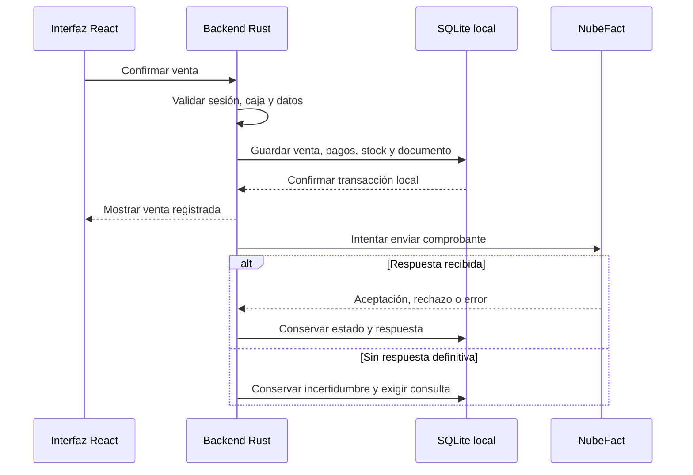

### 6.3. Esquema SQL v7

**27 tablas de aplicación y 6 vistas.** Historial desde OT finalizadas; estado de envío en comprobantes; cierre con conteo de efectivo y resúmenes digitales. Dinero comercial en céntimos, cantidades UND/ml y costos internos con seis decimales. Bases separadas para Prueba y Producción.

**El SQL inicial es exclusivamente para una base vacía.** Una instalación con datos necesita migración específica y adaptación del código; no reemplazar una migración ya aplicada.

<a id="instalacion"></a>

## 7. Instalación y ejecución

### 7.1. Requisitos

Windows 11 de 64 bits; Node.js/npm compatibles con el proyecto; Rust/Cargo; Microsoft C++ Build Tools con desarrollo de escritorio C++; WebView2 Runtime y Git para clonar. Ver [requisitos oficiales de Tauri](https://v2.tauri.app/start/prerequisites/).

Ejecutar desde la raíz del repositorio, donde está `package.json`.

### 7.2. Instalar dependencias

```powershell
npm install
```

### 7.3. Ejecutar en desarrollo

```powershell
npx tauri dev
```

### 7.4. Compilar

```powershell
npx tauri build
```

La configuración actual de Tauri invoca `npm run dev` antes del desarrollo y `npm run build` antes de compilar. Los scripts existen en `package.json`; el arranque y el instalador se validan en el equipo Windows objetivo.

### 7.5. Configuración inicial definida

1. Empezar en Prueba y crear el primer administrador, sin credenciales predeterminadas.
2. Configurar empresa, NubeFact, series y zanjas; registrar catálogos y existencias.
3. Preparar la protección de copias y validar atención, cobro y cierre antes de Producción.

<a id="pruebas"></a>

## 8. Pruebas y calidad

### 8.1. Qué se verifica

En Login: acceso, sesiones, permisos, bloqueo, recuperación, revocación y consistencia ante fallos. En Ficha Vehicular: registro, edición, identidad histórica, permisos, correcciones, consultas y paginación. En Taller: recepción, estados, responsable, zanjas, servicios, consumos, devoluciones, aceite, auditoría y avisos de resultado. En Inventario: DTO públicos sin costos, catálogos, proveedores, compras, conteos, valoración de granel, kardex, filtros y reintentos sin duplicación de efectos. En POS: ventas directas, cobro de OT sin duplicar insumos, pagos, devoluciones, comprobantes, idempotencia y recuperación documental local. En Caja Chica: apertura idempotente, privacidad entre cajeros, arqueo con control de versión, reversión, aclaración, cierre recuperado e integración con cobros y reintegros del POS. En Backup: copia consistente con WAL, protección local de la frase, archivos ausentes, retención, restauración por generaciones, recuperación de arranque y conciliación de series. En Administración: permisos, cuentas y temporales, validación de ubigeo, control de versiones y dependencias, reversión ante fallos de auditoría, descarte de cambios y conservación de filtros por sesión.

### 8.2. Cómo ejecutarlas

Desde la raíz:

```powershell
npm run typecheck
npm test
npm run build
cargo fmt --manifest-path src-tauri/Cargo.toml -- --check
cargo check --manifest-path src-tauri/Cargo.toml --all-targets
cargo clippy --manifest-path src-tauri/Cargo.toml --all-targets -- -D warnings
cargo test --manifest-path src-tauri/Cargo.toml
```

Para repetir las mediciones del backend de POS, Caja Chica y Administración desde la raíz:

```powershell
cargo test --manifest-path src-tauri/Cargo.toml --test pos_rendimiento_tests -- --ignored --nocapture
cargo test --manifest-path src-tauri/Cargo.toml --test caja_rendimiento_tests -- --ignored --nocapture
cargo test --manifest-path src-tauri/Cargo.toml --test administracion_tests rendimiento_administracion_200_cuentas_20_series -- --ignored --nocapture
```

Las pruebas de integración externas deben usar datos y credenciales de Prueba. El flujo de [GitHub Actions](.github/workflows/ci.yml) define comprobaciones del frontend y backend; sus resultados se consultan en [Actions](https://github.com/JesusLoza1506/lubricentro-erp/actions).

### 8.3. Estado de la validación

La ejecución general en Windows del **9 de noviembre de 2026** reportó los siguientes resultados. Las mediciones de rendimiento corresponden a ejecuciones por separado.

| Comprobación                                      | Resultado reportado                                                                                                                                                    |
| ------------------------------------------------- | ---------------------------------------------------------------------------------------------------------------------------------------------------------------------- |
| Formato Rust, `cargo check` y Clippy              | Aprobados.                                                                                                                                                             |
| TypeScript y compilación del frontend             | Aprobadas.                                                                                                                                                             |
| Pruebas de frontend y servicios                   | **141 aprobadas** en **20 archivos**, incluidas **11 de Administración**, **6 de Backup** y **3 de Caja Chica**. |
| Suite general de Rust (`cargo test`)              | **148 aprobadas**, **0 fallidas** y **4 mediciones omitidas por defecto**. |
| Suite Rust de POS                                 | **20 aprobadas**, incluida la integración con Caja Chica. |
| Suite Rust de Caja Chica                          | **4 aprobadas**.                                                                                                                                                       |
| Pruebas Rust de Backup y Copias                   | **10 aprobadas**, incluidas las de recuperación y de interrupción simulada.                                                                                            |
| Suite funcional de Administración en Rust         | **11 aprobadas**. Incluye ubigeo, edición obsoleta, dependencias nuevas y reversión ante fallos de auditoría. |
| Rendimiento de POS, ejecutado por separado        | **1 prueba aprobada** con cinco muestras y **5.000 ventas** en SQLite temporal en disco.                                                                               |
| Rendimiento de Caja Chica, reportado por separado | **1 prueba aprobada** con **5.000 turnos y 100.000 movimientos** en SQLite temporal en disco. Las **20 muestras** por operación quedaron por debajo de **2 segundos**. |
| Rendimiento de Administración, por separado       | **1 prueba aprobada** con **200 cuentas y 20 series** en SQLite en memoria; **20 de 20 muestras** por operación dentro de **2 segundos**. |

**Rendimiento del POS:** el listado promedió **44,76 ms** (36,27–50,18 ms) y la confirmación local **7,46 ms** (4,47–14,98 ms). La prueba mide el backend local; todavía falta validar el tiempo visible en WebView y el recorrido con NubeFact de Prueba.

**Rendimiento de Caja Chica:** la medición abarca el resumen, la primera página de movimientos y el cierre en Rust. Queda por medir el recorrido completo desde la interfaz en Tauri.

**Rendimiento de Backup:** en la revisión anterior, generar y verificar tomó **31,66–37,34 s** y seleccionar y comprobar tomó **23,14–29,21 s** en cinco muestras con aproximadamente **100 MB de SQLite y 100 MB de archivos**. La medición se hizo en disco local con datos ficticios; queda pendiente medir USB y el recorrido completo en Tauri.

**Rendimiento de Administración:** en Windows, la primera página más las series tomó **0,51–1,05 ms** y guardar con cálculo del hash tomó **404–600 ms**. La prueba mide el backend con SQLite en memoria. Quedan pendientes las mediciones con SQLite en disco y desde la interfaz en Tauri.

**Evidencia previa de Inventario:** las consultas de catálogo, críticos y kardex con **1.000 productos y 10.000 movimientos** registraron aproximadamente **0,2–1,8 ms** en SQLite en memoria. Los tres casos de conteo reproducidos permanecen entre los pendientes de Inventario. Taller conserva como pendiente las cinco mediciones con **2.000 OT**.

**Esquema verificado en SQLite:** 27 casos satisfactorios sobre creación, restricciones, relaciones y flujos seleccionados, correspondientes al esquema revisado. Esta evidencia se distingue de las pruebas de los módulos y no acredita la integración completa con NubeFact. Las revisiones de Login disponibles se enlazan en Documentación.

<a id="documentacion"></a>

## 9. Documentación

| Recurso                                                                  | Contenido                          |
| ------------------------------------------------------------------------ | ---------------------------------- |
| [Carpeta docs](docs/)                                                    | Documentos actualmente publicados. |
| [Revisión de Login v7 — R4](docs/Reevaluacion_Login_v7_2026-10-17_R4.md) | Revisión del módulo de acceso.     |
| [Comandos Tauri](docs/api/tauri-commands.md)                             | Referencia técnica existente.      |
| [Wireframes y diseño](docs/ui/wireframes-y-diseno.md)                    | Referencia de interfaz existente.  |
| [Esquema SQL v7](src-tauri/migrations/0001_initial_schema_v7.sql)        | Modelo inicial de datos.           |

El informe general y las diez especificaciones funcionales v7 son documentos de referencia; sus enlaces se incorporarán cuando estén publicados en el repositorio. Los cambios de reglas deben reflejarse en código, documentación y esquema cuando corresponda.

<a id="hoja-de-ruta"></a>

## 10. Hoja de ruta

Los ocho primeros módulos están en ajustes finales; **el siguiente módulo será Reportes**.

1. **Login y Sesión — ajustes finales (95/100):** completar recuperación del error inicial y evidencias de teclado, foco, salida y tiempos de ingreso.
2. **Ficha Vehicular e Historial — ajustes finales (93/100):** activar cambios pendientes al modificar datos, consolidar pruebas de interfaz y completar mediciones de escritorio.
3. **Órdenes de Trabajo Taller — ajustes finales (93/100):** conservar identificadores al reintentar, completar auditoría de servicios y validar recorridos y rendimiento.
4. **Inventario y Stock — ajustes finales (95/100):** resolver los casos particulares de conteo y costos, proteger capturas modificadas y completar pruebas y mediciones en escritorio.
5. **Punto de Venta POS — ajustes finales (95/100):** mostrar el último intento documental y completar las pruebas de NubeFact de Prueba, impresión, recorridos en Tauri y rendimiento visible.
6. **Caja Chica — ajustes finales (94/100):** corregir la respuesta tardía al regresar al historial y completar las pruebas de interfaz, impresión, medianoche en Lima y rendimiento en escritorio.
7. **Backup y Copias — ajustes finales (94/100):** estabilizar las pruebas de interfaz y completar las verificaciones de fallos, recuperación en Windows y guardado externo.
8. **Administración — ajustes finales (96/100):** completar la validación en Tauri, el almacén de credenciales de Windows, los recorridos con POS y Backup y la medición con SQLite en disco.
9. **Reportes — pendiente · próximo módulo:** integrar las consultas y exportaciones autorizadas de los módulos anteriores.
10. **Inicio Dashboard — pendiente de integración final:** integrar los indicadores y resúmenes por rol después de Reportes.

Cada módulo tendrá su detalle plegable, capturas y evidencias conforme avance. Pasar a la siguiente etapa no elimina los pendientes de los módulos anteriores. Este orden de desarrollo no modifica el flujo operativo del taller descrito en la sección 5.

<a id="autor"></a>

## 11. Autores y licencia

- **Jesús Ángel Loza Yataco**
- **Esteban Ricardo Puma Palomino**
- **Reyes Esterripa Carlos Edén**
- **Magallanes Llanos Juan Jesús**

**Estudiantes de Ingeniería de Sistemas — Perú.** Proyecto académico para aplicar desarrollo, diseño de datos, integración de servicios y aseguramiento de la calidad a la gestión de un lubricentro.

**Licencia:** este README no incorpora una licencia de uso o distribución; su elección corresponde al acuerdo de los autores.
